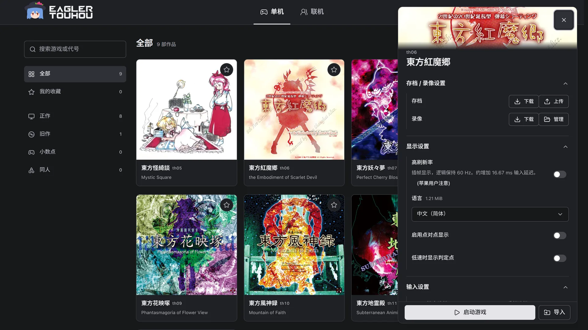
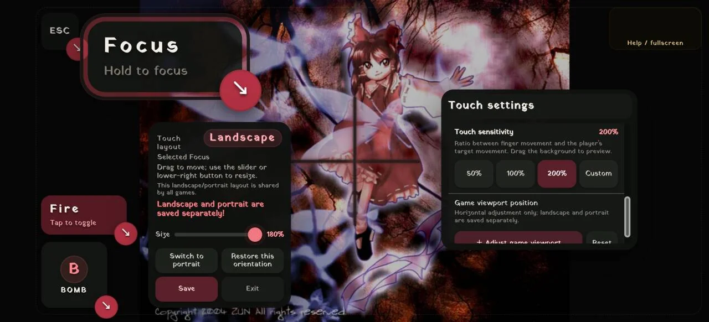
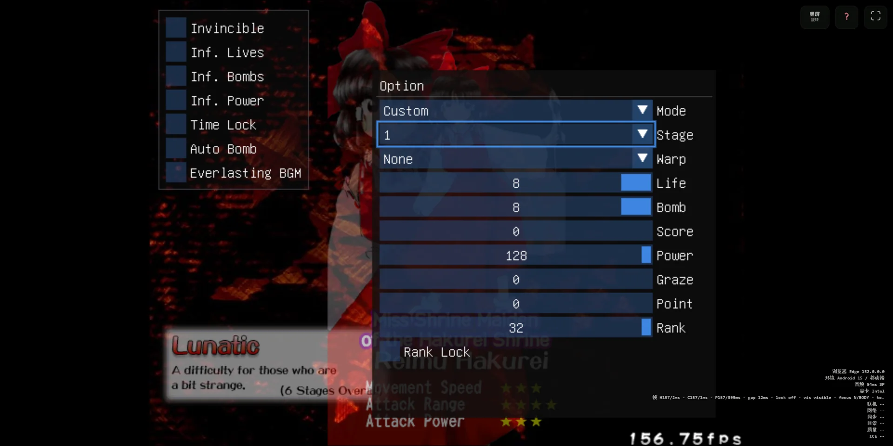
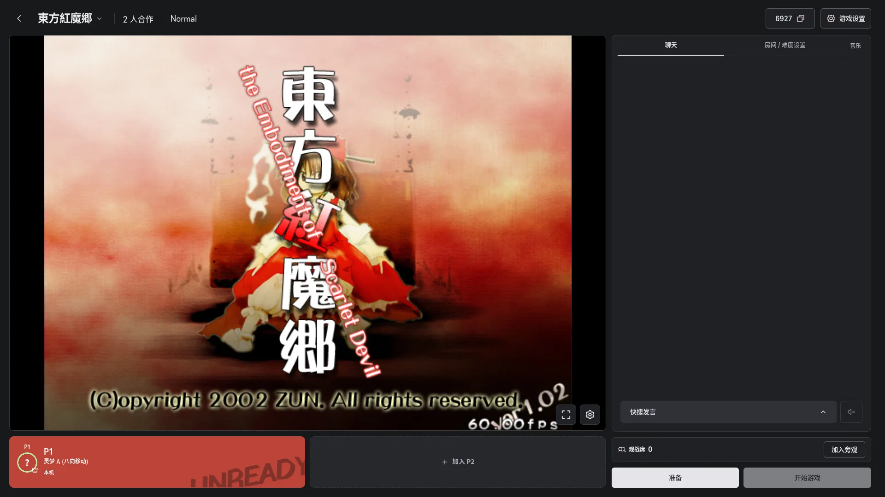

<h1 align="center">
  
</h1>

  
A project to bring official Touhou Project games, fan games, community tools, and multiplayer mods to <strong>every platform</strong>, aiming to <strong>greatly lower the barrier to entry for players</strong>.

  

    
    
    
    =108">
    
  

  
<a href="README.md">简体中文</a> | English

> [!WARNING]
> For now, support for every platform is delivered through Web adaptations. The Web allows rapid iteration and makes games playable across all platforms.
>
> Native versions for individual platforms are planned to address performance and other concerns.

> [!TIP]
> For game support, see the [Game Restoration and Adaptation Progress](docs/TOUHOU_PROGRESS.md). 
> If you have started working on a game, submit an Issue or PR to update the table. 
> If you are interested in reverse engineering the original games or adapting official games and Touhou fangames, join our [Discord](https://discord.gg/HwVz9ZTSF) or [QQ group](https://qm.qq.com/q/eeUrxIltug?from=tim). We also have a developer group.

## Overview

The project's basic goal is to let users play **on any modern device without barriers**.

While preserving the original game experience, including some original bugs:

1. Provide high refresh rates, touch controls (direct movement and menu gestures), and popular STG community tools (thcrap and thprac).
2. Provide multiplayer built primarily around predictive rollback, with input delay as a supplement and strong tolerance for high latency.
3. Provide an updatable Web App that manages touch layouts, saves, and Replays and keeps working offline.
4. Provide a multiplayer lobby where players can join or spectate a game with just a few button presses.
5. Provide accounts and cloud saves, so you can keep playing on another device.
6. Maintain an active development team that updates quickly and welcomes feedback and criticism.

## Available Titles

These nine titles are playable at [touhouonline.com](https://touhouonline.com/).

| Title | High refresh rate | thprac | Languages | Multiplayer |
| :--- | :---: | :---: | :---: | :---: |
| **th05** Mystic Square | - | ✅ | ✅ | Co-op, 2–3 players |
| **th06** Embodiment of Scarlet Devil | ✅ | ✅ | ✅ | Co-op, 2–3 players |
| **th07** Perfect Cherry Blossom | ✅ | ✅ | ✅ | Co-op, 2–3 players |
| **th08** Imperishable Night | ✅ | ✅ | ✅ | Co-op, 2–3 players |
| **th09** Phantasmagoria of Flower View | - | - | ✅ | Versus, 2 players |
| **th10** Mountain of Faith | ✅ | ✅ | ✅ | Co-op, 2–3 players |
| **th11** Subterranean Animism | ✅ | ✅ | ✅ | Co-op, 2–3 players |
| **th12** Undefined Fantastic Object | ✅ | ✅ | ✅ | Co-op, 2–3 players |
| **th15** Legacy of Lunatic Kingdom | ✅ | ✅ | ✅ | Co-op, 2–3 players |

Every title supports keyboard, gamepad, and touch, and can be spectated online.

For other titles, see the [game progress table](docs/TOUHOU_PROGRESS.md). Enable early-access titles under Developer options → Beta features in the top-right menu.

## Features

### The Complete Original Game Experience

- Run games in the browser with keyboard, gamepad, and touch controls.
- Import and export original-format saves and Replays. Inputs supported by the original format remain interoperable; adaptation inputs that it cannot record use extension data.
- Aims for a polished experience. It fixes numerous issues inherited from the original portable branches, including jittery bullets, uneven bullet movement, flickering, music stutters when switching tracks in single-threaded mode, and poor performance on phones.
- Supports refresh rates above 60 Hz; game logic stays at the original 60 Hz. \[Thanks to [reallyportable](https://github.com/some100/th07/tree/reallyportable)\]
- th06, th07, and th08 can play OGG or MIDI music.
- th05 runs on [uth05win](https://github.com/Goan114/uth05win-vibe) and supports Replays and multiplayer too.
- The library supports search, favorites, sorting, and categories.
- Replays can be organized in folders; pick one to play it.
- The interface comes in Simplified Chinese, English, and Japanese, with dark and light themes.

See [Available Titles](#available-titles) for what each title supports.

### Input Settings

The default-expanded Input Settings group sits above Advanced Settings. The Keyboard tab provides Arrow keys and WASD presets plus named custom layouts. The Gamepad tab supports per-device button/axis learning, thresholds, and saved profiles. When enabled, Launcher gamepad mapping takes priority over in-game controller settings and requires updated Runtime packages.

The WASD layout retains original controls: arrows / WASD to move, Z / K to shoot, X / J for Bomb, Shift / L / Space to focus, and C / H for the title's existing C action. New aliases take priority when keys conflict and require updated game Runtime packages.

TH09 has a separate Local two-player editor with per-player keyboard/controller selection, saved layouts and conflict checks. Original left/right keyboard halves, WASD and arrow-key presets are available. Enabling it overrides local versus device settings without changing single-player or online mappings.

### Touch Controls

- Your touch path becomes the player's movement path. Available movement methods include Touch, Touch (cheat, unlimited speed), Joystick, and more. \[Thanks to [reallyportable](https://github.com/some100/th07/tree/reallyportable)\]
- Customizable touch layouts. Touch buttons can be freely moved and scaled from 60% to 300%.
- Landscape and portrait layouts can be saved separately.
- Rolling back to an older Launcher resets saved layouts that use scales above 180%.
- A Magnifier lets players zoom the game viewport at any time with a two-finger gesture. No more losing bullets because they are too small to see (x
- Touch Replays preserve the touch trajectory actually sent to the game.
- Menu gestures: swipe to move the selection cursor, tap to confirm, and tap with two fingers to go back. \[by [reallyportable](https://github.com/some100/th07/tree/reallyportable)\]
- Adjustable touch sensitivity.
- Adjustable default game viewport position.
- Multiple Focus methods, including hold, toggle, and two-finger controls.

### Popular STG Community Tools

#### thprac

- Provides [thprac](https://github.com/touhouworldcup/thprac) integration; see [Available Titles](#available-titles) for supported titles.
- Touch devices can operate practice menus, with virtual buttons for opening the Tab Tracker and cheat menu.
- Practice Replays record their practice parameters and can be played back in the Launcher.

#### thcrap Languages

- Provides [thcrap](https://srv.thpatch.net/) language-pack support.
- Available languages depend on the game adaptation and the packs offered by the site.
- Servers can choose which language packs to offer for each game. You can throw in a whole pile of unusual language packs; players download only the one they select.

### Multiplayer Lobby

- Every available title has a multiplayer version. th09 is 2-player versus; the rest are 2–3 player co-op.
- th06MP and th07MP are based on the [th07MP rules](https://github.com/sbrik1111/th07_multi_player).
- In co-op, you can give teammates lives and Power. Giving a life revives a teammate who has become a ghost. Full rules are in the [multiplayer guide](launcher/content/MULTIPLAYER.md) (Chinese).
- Every character and stage is unlocked online.
- Predictive rollback can be toggled in the room. With it off, input delay is used instead.
- The lobby lists public rooms, ready to join or spectate.
- To create a room, pick a title, then send the room code or invite link to your friends. Unlisted rooms do not appear in the lobby.
- In the room, pick a seat, character, and difficulty. The host starts the game once everyone is ready.
- Rooms have chat, quick chat, and Listen together for music.
- Players connect directly over WebRTC and switch to a TURN relay automatically when that fails. If you cannot connect, try Check network in the lobby first.
- Any player can pause. Press R while paused to restart the run.
- Multiplayer Replays can be saved, by spectators too.
- Spectators do not occupy player seats and can only watch.
- In th06, th07, th08, th10, th11, and th15, spectators can join after the game has started and look back along the timeline.
- Single-player and multiplayer saves and Replays are isolated. Settings may still be shared.

### Accounts and Profiles

- Playing and multiplayer work without signing in.
- Signing in adds a profile, friends, and cloud saves. The profile shows your clear chart and play history.
- Cloud saves sync your saves across devices. When local and cloud progress differ, you choose which one to keep.

### Game Packages and Offline Play

- Install game packages from the site or import a ZIP containing a legally owned copy of the game.
- Installed packages remain in the browser. Game data, OGG music, fonts, and language packs can be managed independently, while Runtime components are provided by the site.
- The Launcher can be installed as an app. In secure contexts such as HTTPS or a trusted loopback address, installed games and the Launcher can run offline.
- Original game data imported by the player is never uploaded to the server; it remains in the browser.

Operators can choose among three modes based on their resources and bandwidth:

- **Hosted**: the site serves the Launcher, Runtime components, and all game resources. Players can install games directly, while the site carries all resource traffic;
- **External**: the user-facing site serves the Launcher and Runtime components, while a separate complete resource site or CDN serves large game files. Players can still install games directly without sending large-file traffic through the frontend server;
- **Import**: the site serves only the Launcher and Runtime components and does not publish original game data. Players import a ZIP made from their legally owned game copy. This suits operators without a CDN traffic budget or who do not want to host original resources.

All three modes share the same frontend, browser-local game packages, and offline-play support. Self-hosted sites run in guest mode by default, and multiplayer works without an account service. See the [self-hosting guide](launcher/docs/SELF_HOSTING.md) for complete deployment instructions.

## Contributing

| Directory | Contents |
| :--- | :--- |
| [`launcher/`](launcher/README.en.md) | Launcher and multiplayer lobby |
| [`ports/`](ports/README.md) | Runtime and multiplayer version of each title |
| [`common/`](common/README.md) | Runtime library and contracts shared by all titles |
| `services/` | Relay, TURN, resource router, and telemetry |
| [`docs/`](docs/README.md) | Adaptation workflow, netplay architecture, and game progress |

Start with [CONTRIBUTING.md](CONTRIBUTING.md), then pick a component in [WORKSPACE.md](WORKSPACE.md). All documents are in the [documentation index](docs/INDEX.md). (Developer documentation is in Chinese.)

## Frequently Asked Questions

See the [FAQ](launcher/docs/FAQ.md). The website page is generated from this Markdown source. (Only Chinese is currently available.)

## License

The Launcher is licensed under the [GNU General Public License v3.0 or later](launcher/LICENSE).

Complete third-party source, asset attribution, and licensing information is available in [THIRD_PARTY.md](launcher/THIRD_PARTY.md) and [ASSETS.md](launcher/ASSETS.md).

## Star History

