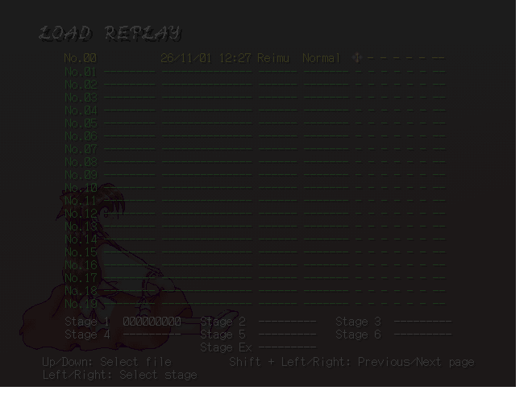

# TH05 原生 Eagler 验收

uth05win 的 C++ 游戏逻辑直接编译为 Wasm／GLES2，使用当前启动器的资源、语言、存档与输入协议。原版和 thprac 共用 `th05.wasm`，音效与两套 BGM 分别管理。

本次在 Windows、Node.js 26.7.0、Emscripten 6.0.9 和 Chromium 软件 WebGL 环境验收。[检查总表](checks.json)记录命令、结果与范围；[生产构建](runtime-build.json)和[Runtime 文件身份](runtime-files.json)固定程序内容。

| 验收 | 证据 |
| --- | --- |
| 真实启动器启动中文＋thprac＋幺乐团专辑版，以及日文＋原版＋全量解码 BGM | [启动器结果](launcher.json) |
| 原版与练习开关、三种练习语言、中文代码页、暂停重开、共享手柄输入、持久化 Replay | [生产浏览器结果](browser-production.json) |
| 4 角色 × 7 关卡 × 3 起点，共 84 个原生游戏样本，每项最多执行 160 步 | [诊断浏览器结果](browser-native.json) |
| 实际触控位移记录与回放：24 帧角色坐标逐帧一致；工作区检查、定位、倍速、结束状态 | [生产浏览器结果](browser-production.json) |
| PR 文件校验、原版流式／全量解码、幺乐团专辑播放状态和循环点；暂停或关闭 BGM 后保留 FM 音效 | [音频来源身份](audio-source.json)、[浏览器结果](browser-production.json) |
| 启动器设置、资源获取与配置回归 71 项 | [设置检查](launcher-settings.log) |
| 外部打包与 Runtime 身份检查 8 项 | [打包检查](external-packaging.log) |
| 原仓库祖先、子树连接及当前候选目录导出树一致 | [来源历史](source-history.json) |

原生矩阵验证关卡初始化和短步进，完整通关与原版逐帧基准按[适配表](../../ports/th05/ADAPTATION.md)继续维护。音频检查核对实际文件、解码和浏览器播放状态。

工作区完整套件初次运行 1588 项，其中 1579 项通过。外部打包项随后定向重测通过；7 个返回房间用例仍报告 `.room-workspace-fullscreen` 缺失。TH06 的同一错误在改动前 `4dff5b2fd` 复现，见[基线检查](baseline-room.log)。

[标题画面](title.png) · [启动器练习／专辑模式](launcher-practice-akyu.png) · [启动器原版模式](launcher-vanilla-original.png) · [开发指南](../../ports/th05/docs/DEVELOPMENT.md)
