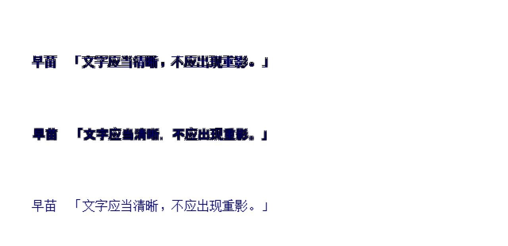
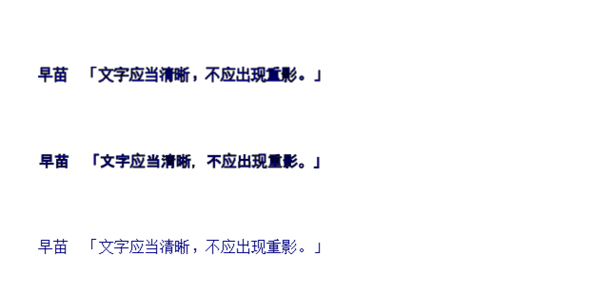

# TH12 结局与对话文字描边

TH12 普通版和多人版的结局、对话文字使用同一条纹理栅格化路径。共享字体的细笔画在旧描边实现中出现多副字形：每个文本片段会在四个偏移位置填充黑字，再填充正文。结局描边还额外减去两个源像素，导致轮廓与正文的基线不一致。

修复改为在正文基线上绘制一次连续轮廓，再绘制一次前景文字。轮廓宽度为两个源像素，常规二倍文字纹理下约为一个逻辑像素的总线宽；颜色读取文字描边配置，显式关闭描边的路径继续保持纯文字。文字布局、分行、颜色、动画和缓存入口沿用现有实现。

## 对照

以下 Chromium 截图采用本地共享 `unifont.otf` 和样例文字。三行依次为结局配置、对话配置和关闭描边的对照；它们验证局部文字绘制。

修复前：

修复后：

## 验证

- 两侧新增浏览器回归分别检查原文和中文语言提供器下的结局、对话、符卡标题及纯文字配置。每个片段的前景只绘制一次，轮廓与前景位置一致，缓存复用不重复栅格化，并核对 WebGL 输出和错误状态。
- 旧实现会触发新增回归失败；修复后通过。
- 128 项绘制相关检查通过；另有 4 项结局时间线与完整结局分支检查、6 项 TH12 语言布局与补丁检查通过。

本次修改保留在 `fix/th12-extra-green-laser` 修复分支，站点发布仍为此前的激光预告线修复版本。
