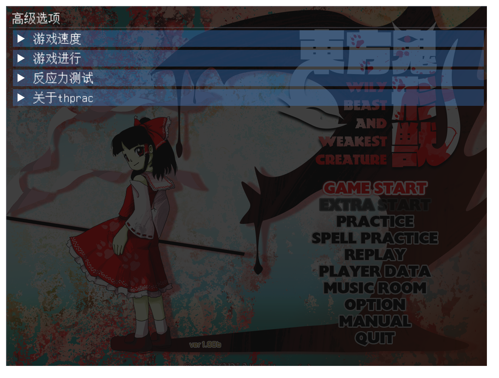
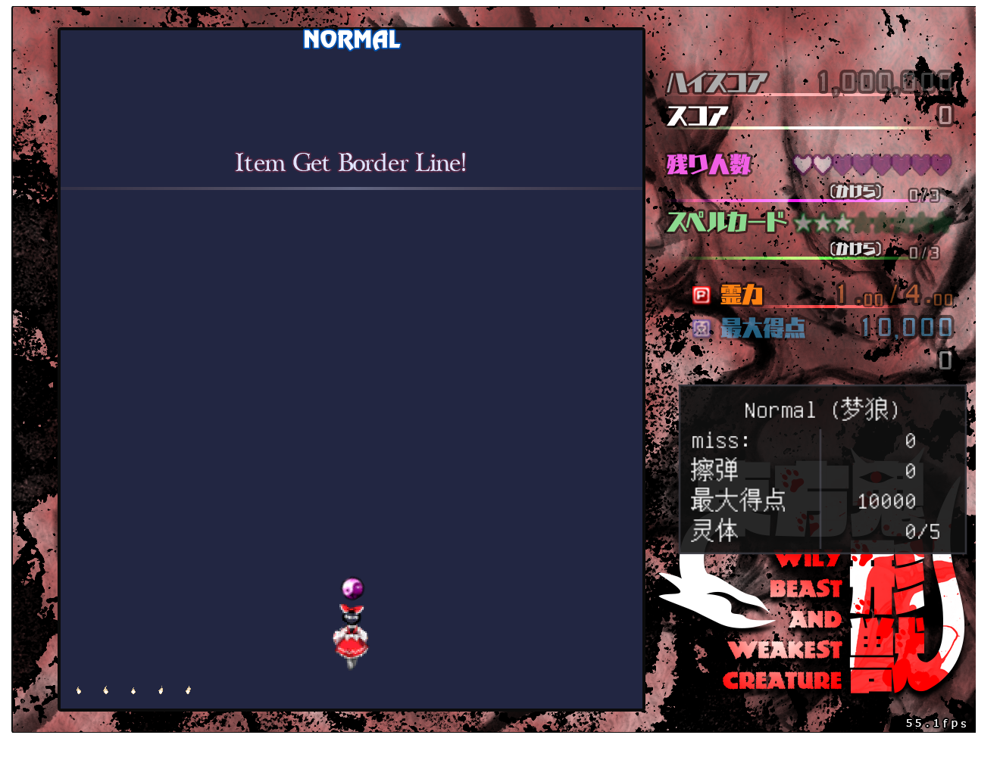

# TH17 单人快捷键、换面与实例绘制 · 2026-11-07

单人模式按原结算流程保留上一关背景：等待 Stage Clear 提示结束，再推进两侧背景的淡出与淡入。Tab、Backspace 使用完整虚拟键值；暂停界面的 R 键直接选择 Restart，再进入原确认流程。F12、Tab 和 Backspace 的桌面窗口可与启动器触控面板同时使用，触控命令继续控制手机面板的折叠状态。

普通版与多人版共同精简实例绘制状态。每个实例 VAO 在创建时启用九个实例属性并设置 divisor，后续批次按偏移更新指针。ImGui 与重采样沿各自 VAO 工作，战斗状态、顶点数据与绘制顺序保持既有流程。

## 单人浏览器验证

本轮浏览器使用真实 hosted 输入、RAF、原始游戏资源与 1280×960 输出。诊断模块提供只读状态与强制结算入口，发布打包继续拒绝所有诊断导出。回归覆盖：

- 手机面板关闭和开启且隐藏两种状态下，F12 高级设置、Backspace 菜单和 Tab 状态信息均可用；原生 DOM F12 与 hosted 命令均通过。
- 暂停菜单初始选中 Resume 时，R 选择 Restart，原确认动画完成后重新进入游戏。
- 真实结算到下一关的 220 帧中，提示等待期的入场倒计时保持 60，出场倒计时保持 30；随后淡出、释放上一关并启动下一关。





[单人完整回归数据](single-player-report.json)记录窗口状态、重开结果与逐帧换面数据。诊断 Wasm 为 `adc79dc136869d5988efa62219c9fd149ee8e1b4c66abfb7118a8e4f2d22db7d`，游戏实现与本轮发布源码一致。

复测入口使用普通运行包与开发模块分别指定，数据和字体从本地提供：

```powershell
$env:EAGLER_TH17_BUILD = '<普通运行包>'
$env:TH17_SINGLE_MODULE = '<开发构建目录>/th17-application.mjs'
$env:EAGLER_TH17_DATA = '<th17.dat>'
$env:EAGLER_TH17_SHARED = '<包含 msgothic.ttc 和 unifont.otf 的目录>'
$env:TH17_SINGLE_EVIDENCE = '<输出目录>'
node ports/th17/web/tests/single-player-browser.mjs
```

开发模块通过 `node ports/th17/web/scripts/build-sdl-application.mjs --thprac` 构建；额外诊断导出限定在 `TH17_DEVELOPMENT_HARNESS` 内。

## 多人绘制调用与普通关长跑

Intel 核显、1280×960、110 ms 注入延迟和 2 倍 CPU 限速下，双人和三人各核对约 1,050 个确认帧。浏览器直接计数 WebGL 调用，验证实例属性的一次性设置：

| 三人每席调用 | 基线范围 | 更新后 |
| --- | ---: | ---: |
| `enableVertexAttribArray` | 411,788～413,750 | 11 |
| `vertexAttribDivisor` | 411,786～413,748 | 9 |

计数从启动完成后开始，包含新的战斗 VAO；实例指针和绘制调用继续按实际批次执行。[基线](multiplayer-gl-before.json)与[更新后](multiplayer-gl-after.json)报告保存双人、三人逐席计数与确认帧。设置 `TH17_ROOM_GL_TRACE=1` 可复测调用次数，性能长跑使用默认关闭的计数器。

开启 OGG 音乐的正式多人运行包以三个独立页面连接本地 Relay，145 ms 注入延迟、4 倍 CPU 限速，普通一面跑至二面。8,910 个确认帧在三端一致，覆盖 1,395 帧 Boss 非符、992 帧符卡和 241 帧二面。实际呈现为 58.61 / 58.83 / 58.71 FPS，一面符卡段为 59.87 / 59.69 / 59.91 FPS。最大呈现间隔为 591.16 / 608.46 / 606.06 ms，覆盖同步换面。[完整报告](multiplayer-story-ogg.json)单列音乐、分段呈现、快照、堆占用与修正次数。

本轮以 WebGL 调用次数验证实例状态降耗；长跑数值用于描述本机发布构建的实际呈现。换面加载峰值继续沿独立资源加载指标优化。

## 发布身份与目录历史

主站于北京时间 2026-11-07 08:59:57 发布，公网 28 个运行文件的长度、SHA-256、版本入口与 Wasm MIME 全部通过校验。

| 项目 | 身份 |
| --- | --- |
| 游戏源码提交 | `e230de27135e855645105092fcd2ff660b0831d1` |
| 普通运行包 | `1.0.14-eagler-c3bd09f2033c` |
| 多人运行包 | `1.0.14-eagler-cfafe6b9d1d9` |
| 主站 Release | `sha256-487e77439691ec308c5c89926b38939469fd20c1cdd724bab2ca2e18de63a5cf` |

普通版 221 个源码、261 个头文件和多人版 233 个源码、302 个头文件与构建输入逐项一致。两项原生联机回归通过。普通版修改经临时克隆合并、完整 MP 内容树核对和双父写回接入，多人版沿独立房间测试维护；单人 thprac 浏览器测试归属普通版。标准 MP 子树导出与投影均为 `43ea19250132e9fe56766e2e29dd89389103ac83`，包含普通版投影 `ffe7b105fc0db22f2d53618911d83d0e0f331c42`，两侧保留初始作品祖先。

[构建和历史校验](verification.json) · [历史写回](history-writeback.json) · [发布回执](activation.json) · [公网验证](public-verification.json)
