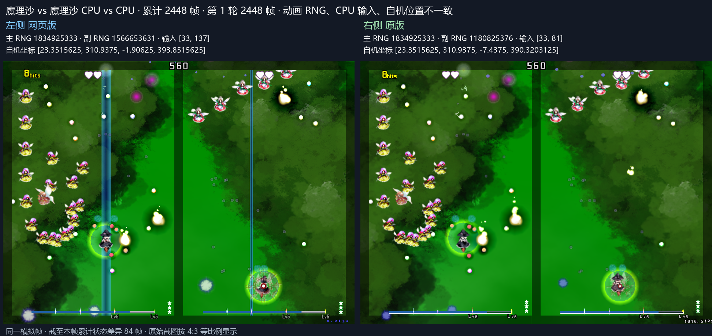
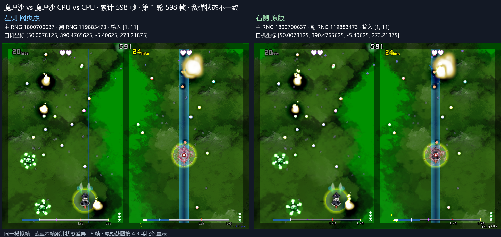
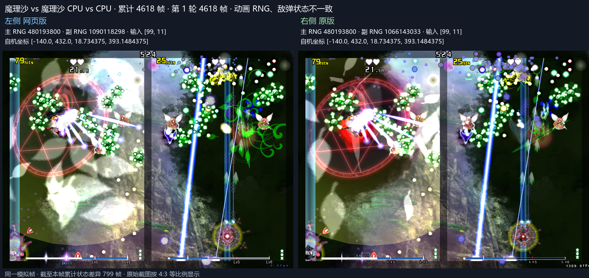
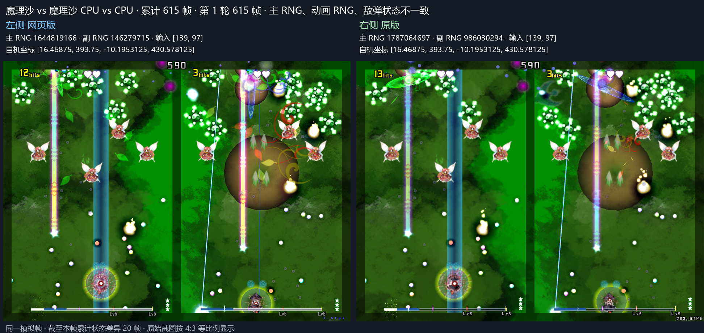
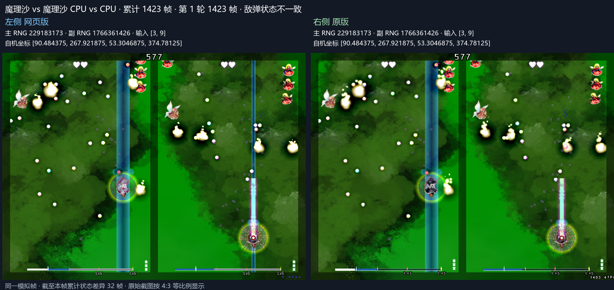

# 魔理沙镜像五种子长程验证

PR #214 的提交 `9c0eb6512b610ebcaa291724e8e64ba658371a3f` 已完成额外五组种子测试，每组累计比较 36000 帧，共 180000 帧。设置沿用 Lunatic、魔理沙 vs 魔理沙、CPU vs CPU、两命、无卡、600 秒。五组使用同一 WASM `057517cc31b284e5a4a01dfc3cb76d30435b438292dc8c37993e599a15d68e4b`。

| 主种子 | 动画种子 | 比较至 | CPU 输入与自机位置首差 | 主 RNG 首差 | 敌弹数量首差 | 敌弹坐标首差 |
| ---: | ---: | ---: | ---: | ---: | ---: | ---: |
| 1 | 7 | 36000 | 2448 | 2492 | 2497 | 2497 |
| 42 | 2026 | 36000 | 4380 | 4402 | 781 | 598 |
| 20261112 | 424182232 | 36000 | 7017 | 6970 | 4782 | 4618 |
| 123456789 | 987654321 | 36000 | 648 | 564 | 646 | 615 |
| 987654321 | 1357911 | 36000 | 7770 | 7784 | 7818 | 1423 |

五组均已跑到累计 36000 帧，并分别记录了差异。既有种子 3058262 / 424182232 的完整玩法与敌弹坐标对齐结果见 [完成记录](../th19-marisa-parity-20261111/README.md)。

各组第 5395 至 5420 帧回滚重演的状态与画面一致，浏览器错误列表为空。原版换轮第零帧未提供 CPU 或敌弹字段时，覆盖数量按实际字段计数。首差、覆盖范围、原版轨迹哈希和构建哈希见 [results.json](results.json)。

## 复现设置

以 `ports/th19/tools/parity/samples/cpu-lunatic-marisa-marisa-no-cards.bin` 为基础，将头部两个小端 uint32 均写为表中主种子。原版采集用 `--cpu-second-rng` 指定表中动画种子，使用 `--stop-after-ticks 36025` 采满跨轮连续状态。Web 使用相同原版采集执行 `--opening-only --continuous --through 36000 --rollback-window 5395 5420`。

本轮原版状态采集的诊断窗口设为第 1 帧，该帧没有 RNG 调用，采集器的调用日志检查因此返回错误。原版身份、CPU 配置、规则及不少于 36000 帧连续覆盖已通过此前校验，Web 对拍使用了完整逐帧状态。截图补采使用包含实际事件的追踪窗口。

## 首差截图

每组保存首差前一帧、首差帧及相邻后帧。左侧 Web，右侧原版，标题显示模拟帧和差异项目，底部显示累计状态差异帧数。

### 主种子 1

### 主种子 42

### 主种子 20261112

### 主种子 123456789

### 主种子 987654321

## 玩法修复验证

出生帧坐标网格修复及同批玩法修正见 [修复验证](birth-snap-fix.md)，其中列明同构建的 36000 帧基线回归与 5910 帧差异窗口验证范围。
