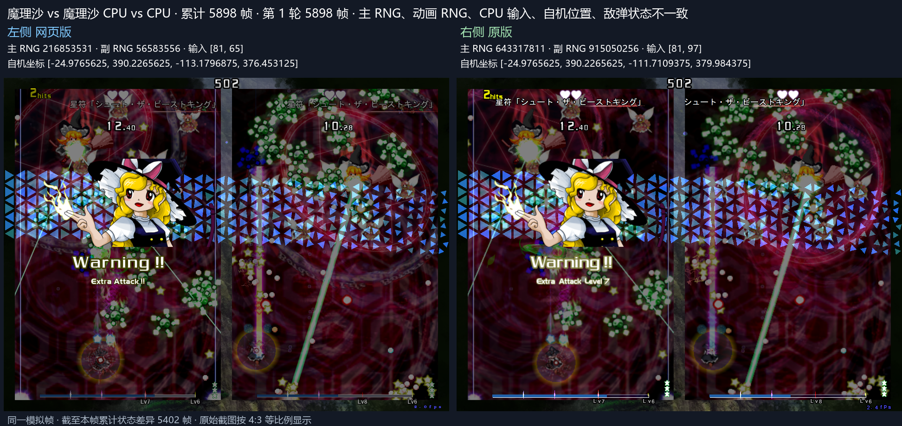
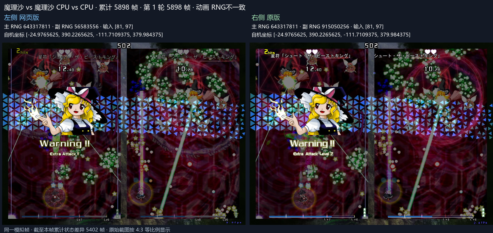

# 普通弹出生帧坐标网格

魔理沙普通弹在出生帧按原版 `0x54ece5` 抵消初速度后，仍由 `0x4d4d41` 将坐标向下取整至 1/100 网格。Web 在出生时重新采样玩家位置后执行同样取整。

主种子 123456789 / 动画种子 987654321：第 5890 帧原版弹心 x=-18.05，修复前 Web x=-18.04。Web 提前命中下方敌机，消耗本应继续飞向上方敌机的 9 点伤害普通弹。修复后通过第 5910 帧，主 RNG、CPU 输入、自机坐标、完整敌弹坐标逐帧一致，敌弹差异帧数为 0。动画 RNG 按本轮范围单独保留。

构建、原版轨迹及回滚结果见 [窗口证据](birth-snap-window.json)。完整多种子长测另行登记。

左 Web、右原版，均为累计第 5898 帧。底部累计状态差异包含已保留的动画 RNG。

原始种子 3058262 / 424182232 同构建完整回归 36000 帧：主 RNG、CPU 输入、自机位置和完整敌弹坐标一致，敌弹差异帧数 0。证据见 [36000 帧基线](birth-snap-baseline-36000.json)。现有 Node 测试 53 项通过。

## 同批玩法修正

- 纯灵到达首帧先执行 Aura 转换脚本，再应用位移。
- 新生反击弹首帧使用全速，后续更新再应用 Aura 半速。
- 已转换动物灵在 CPU 收集目标前执行 ECL。
- 上升中的充能点保持 state 2，自机越过回收线不会立即吸收。
- 直激光圆形切断当帧保留切断前接触矩形，16 单位采样包含末端等号。
- 反击弹类型使用含 banner 的全局攻击时钟，在 3600 帧边界执行原版类型 RNG 取样。

这些逻辑位于普通/MP 共用的 th19 C++ 源码。th19 没有独立的 th19-mp 源码目录。

## 修复构建五种子完整长测

每组均比较至累计 36000 帧。下表为玩法首差，不含单独保留的动画 RNG。构建与覆盖证据见 [完整结果](fixed-results-78e185675.json)。

| 主种子 | 主 RNG 首差 | CPU 输入首差 | 敌弹坐标首差 |
| ---: | ---: | ---: | ---: |
| 1 | 11131 | 11221 | 11133 |
| 42 | 9044 | 9222 | 9052 |
| 20261112 | 11208 | 10721 | 11141 |
| 123456789 | 12357 | 12228 | 12358 |
| 987654321 | 14471 | 14471 | 14472 |
