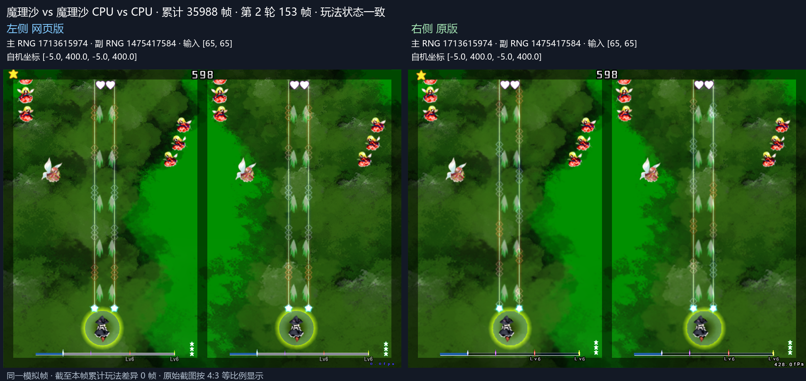

# 魔理沙五种子跨轮 36000 帧验收

魔理沙对魔理沙 Lunatic CPU 对局的五个原始种子均完成跨轮累计 36000 帧验收。每个种子覆盖 10 分钟模拟时间，总计 180000 帧。

| 种子 | 累计帧 | 主随机 | CPU 输入 | 自机位置 | 敌弹数量与位置 |
| --- | --- | --- | --- | --- | --- |
| 1 | 36000 | 一致 | 一致 | 一致 | 一致 |
| 42 | 36000 | 一致 | 一致 | 一致 | 一致 |
| 20261112 | 36000 | 一致 | 一致 | 一致 | 一致 |
| 123456789 | 36000 | 一致 | 一致 | 一致 | 一致 |
| 987654321 | 36000 | 一致 | 一致 | 一致 | 一致 |

最终构建的 WASM SHA-256 为 `3d622d3ffcb5acec2c35f3e8a93d20ea0545a8c006ddd0b9f9f7d11a08a4ce0d`。五个结果使用同一构建，与保存的原版轨迹逐帧比较。轨迹与报告的 SHA-256、换轮数、采样覆盖及加载阶段缺帧登记在 [验收证据](five-seeds-36000-final-20261116.json)。

## 更新时序

新生充能清场 ECL 在玩家移动与拾取物结算后、碰撞检查前执行。圆形清场产生的移动激光残段保留正常更新，玩家接触产生的残段随所属玩家的最终败北回调结束。残段登记保留早期更新标记，并消费当帧晚期管理器更新。网络状态哈希覆盖接触残段归属及当帧退役道具槽。

## 验证

- 987654321 的 35510 至 35565 帧同轮回滚状态一致，恢复后图像一致。
- ANM 生命周期与 234 组原版浮点位模式通过。
- 2000 弹槽饱和与回收、15000 已退役敌人及检查点恢复通过。
- 48 项 Node 测试通过。

动画随机流差异单列于验收证据。跨 ECL 资源代际的检查点恢复受资源代际校验约束，本次跨轮验收采用连续推进。

## 左右对照

累计 35988 帧已进入第二轮第 153 帧，主随机、CPU 输入及自机位置一致，累计玩法差异 0 帧。左侧为网页版，右侧为原版。

26026、26060 与 35988 帧的配对图片及来源哈希见 [配对证据](screenshots/seed987-36000-final/pairs.json)。
