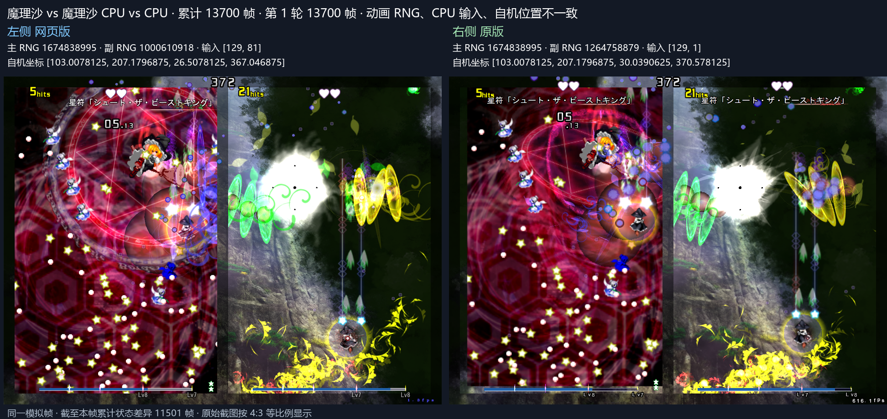
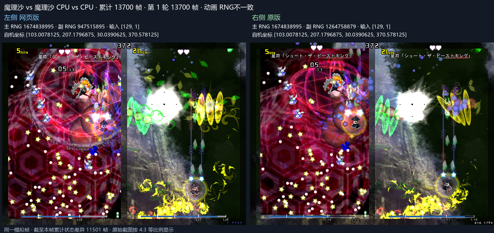

# 全局消弹槽位退出计时

ECL 613 调用原版 0x4edf90，遍历占用槽位并跳过接触取消的 state 3。处于脚本取消 state 4 的槽位再次执行 0x4eeb30，重置退出计时并应用半步位移。Web 使用独立全局消弹入口同步该行为。

种子 1 在第 13683 帧取消的敌弹，于 13696 帧再次全局消弹，原版从 (9.242605,419.739349) 移到 (9.418971,419.562164)，退出计时重置。CPU 于 13700 帧仍读取该槽位。Web 保留相同生命周期后，累计通过 13720 帧，主 RNG、输入、自机位置和敌弹坐标一致。见 [种子 1 窗口](global-clear-seed1-window.json)。

种子 123456789 第 12228 帧避障输入差异同时消除，累计通过 12250 帧。见 [种子 123 窗口](global-clear-seed123-window.json)。53 项 Node 测试通过。

原始种子同构建完整 36000 帧回归通过，见 [基线证据](global-clear-baseline-36000.json)。种子 1 完整比较至 36000 帧，首个敌弹差异推进至 14476 帧，CPU 首差推进至 14570 帧。
