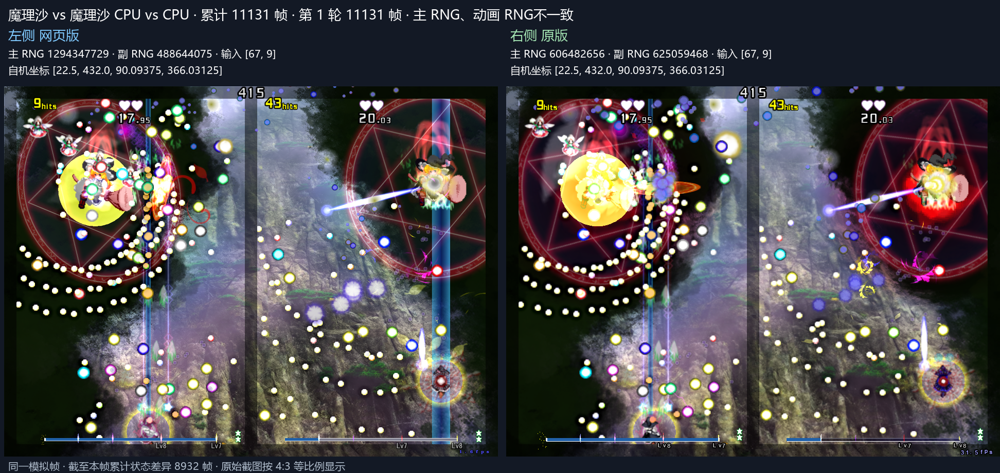
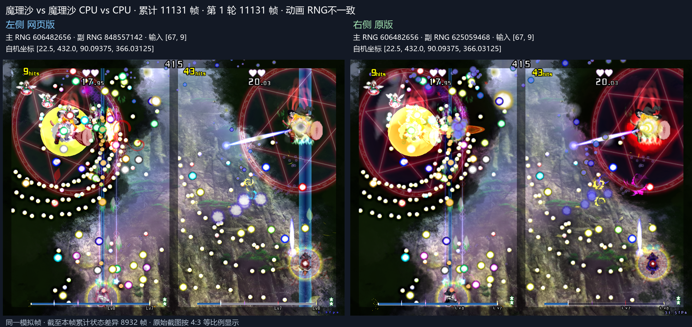
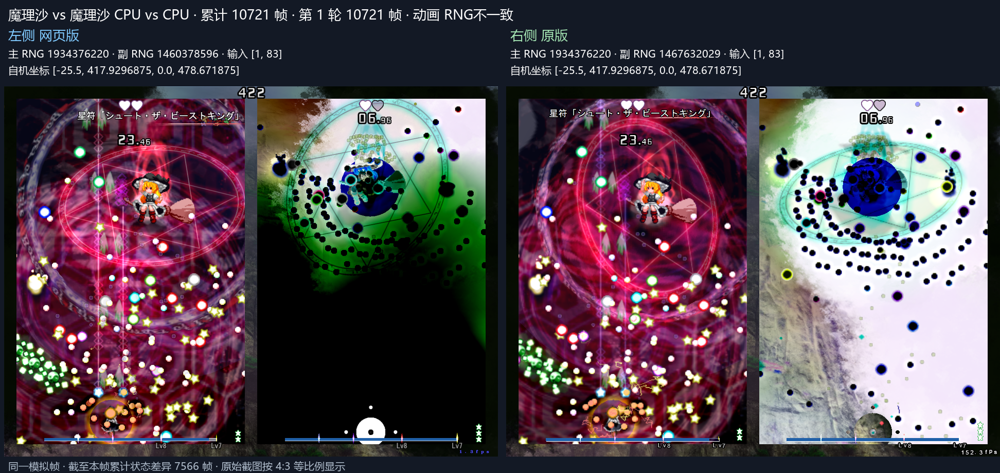

# 激光残段伸长与复活状态

尚在伸长的直激光被切断后，原版从目标长度中扣除被切除长度，保留剩余伸长余量。Web 同步该规则，消除种子 1 第 11131 帧提前擦弹及后续敌弹轨迹分歧。完整长测推进到 CPU 输入首差 13700 帧，主 RNG 首差 13756 帧，敌弹坐标首差 13760 帧。见 [种子 1 长测](growth-seed1-36000.json)。

原始种子 3058262 / 424182232 同构建累计 36000 帧玩法与完整敌弹坐标一致。见 [基线回归](growth-baseline-36000.json)。

角色处于 Dead 状态时，拾取物继续运动，跳过收集与磁化。复活清场保留消弹槽位供 CPU 读取。种子 20261112 第 10721、10753 帧方向分歧消除，窗口验证通过 10780 帧。见 [复活窗口](respawn-window.json)。

以下截图左 Web、右原版，标题和底部标明模拟帧及累计差异。

