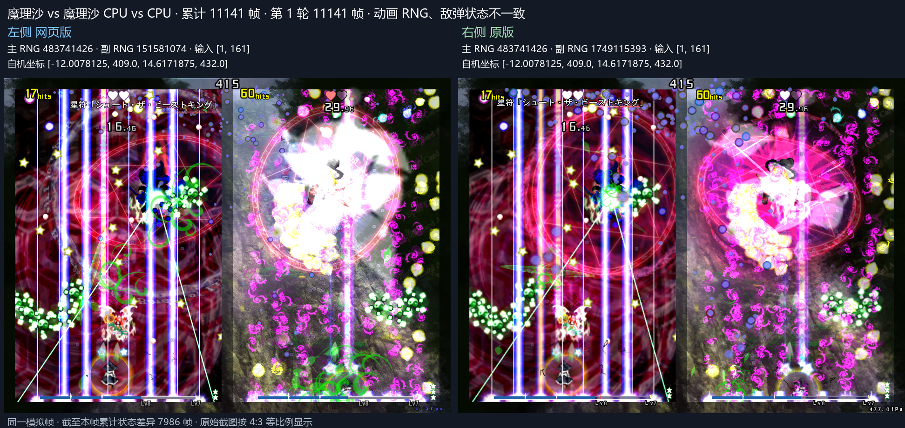
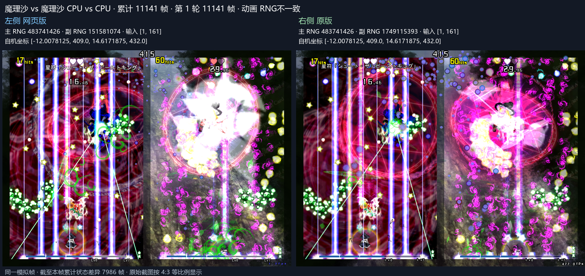

# 跨场死亡圈反击弹顺序

原版在共享飞行管理器中按死亡圈创建顺序处理两侧反射。Web 汇集两场死亡圈，按年龄从小到大稳定排序，同帧按右场敌机先更新、左场后更新的顺序恢复较新的左场优先。

种子 20261112 第 11079 帧两场各反射一颗弹，原版的随机目的地对应不同源弹。修复将目的地与源弹身份一致关联，消除第 11141 帧反击弹场地和坐标差异。通过累计 11165 帧，主 RNG、CPU 输入、自机位置与完整敌弹坐标一致。见 [窗口证据](shared-chain-window.json)。

原始种子同构建累计 36000 帧玩法与敌弹坐标一致，见 [基线证据](shared-chain-baseline-36000.json)。五组各累计比较至 36000 帧，逐组后续首差见 [完整长测](shared-chain-five-seeds.json)。
