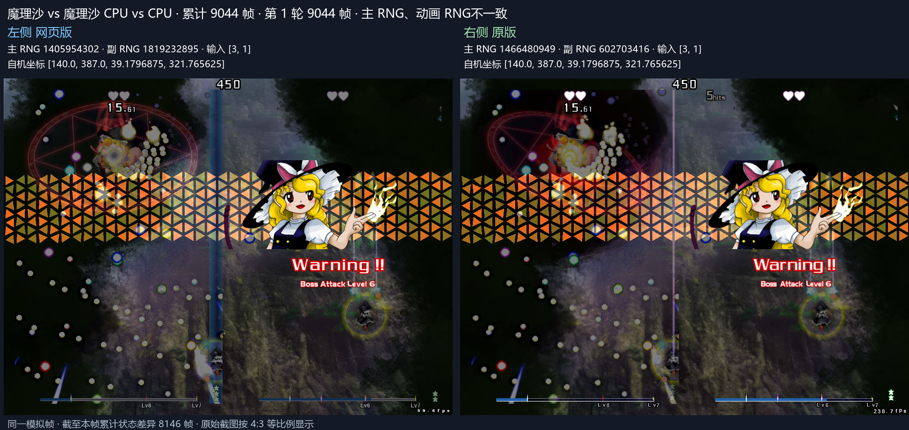
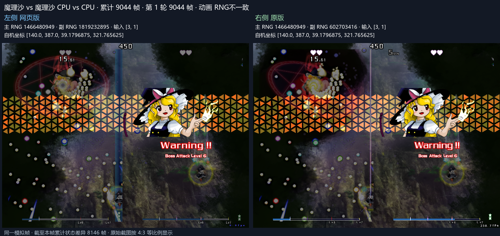

# 直激光分裂的新控制器

圆形消弹将直激光切成多段时，额外片段建立新的原版激光控制器。Web 同步重置新片段的擦弹计时、Aura 减速和移动帧标记，在当帧的后续管理器阶段执行首次移动。

主种子 42 / 动画种子 2026：第 9044 帧原版新片段接触计时从 0 变 1，Web 修复前继承 69，漏过首次擦弹奖励。新片段原版位置 (123.518196,404.351807)，修复前 Web (121.686417,399.602844)，对应缺失的首次移动。修复后通过累计 9060 帧，主 RNG、CPU 输入、自机位置与完整敌弹坐标一致，敌弹差异帧数 0。第 9038 至 9055 帧回滚复验见 [窗口证据](straight-split-window.json)。

同构建完整回归：原始种子 3058262 / 424182232 累计 36000 帧玩法和完整敌弹坐标一致，见 [基线证据](straight-split-baseline-36000.json)。种子 42 累计比较至 36000 帧，敌弹首差推进至 12498 帧，主 RNG 首差 12532 帧，CPU 输入首差 12617 帧，见 [长测结果](straight-split-seed42-36000.json)。
