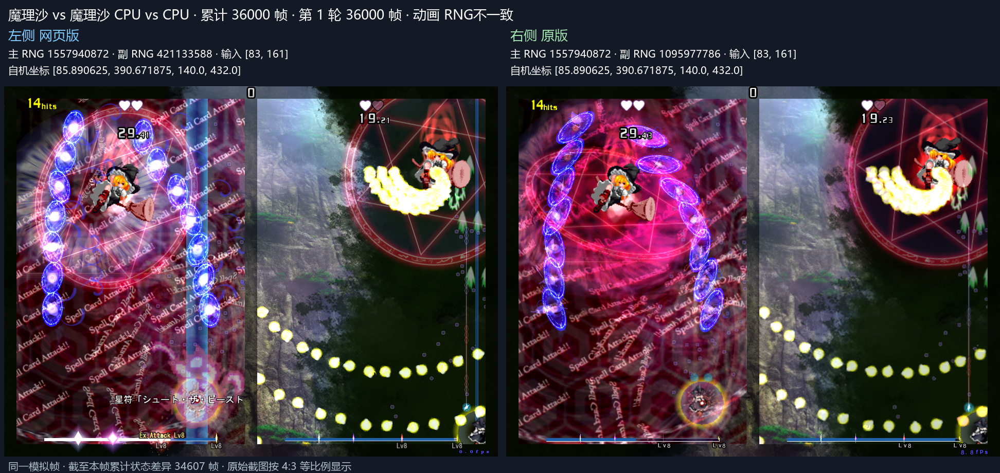
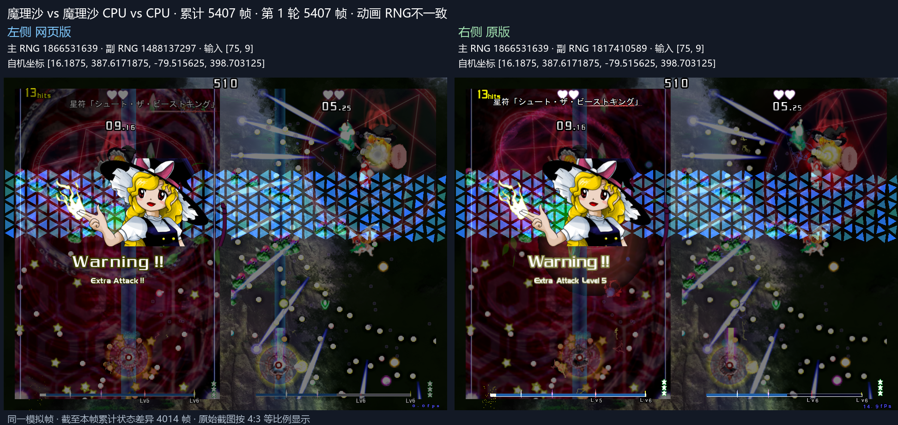
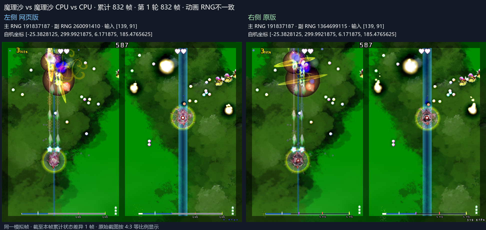

# 魔理沙镜像本地对拍

本记录基于 PR #214 的 `dbd0ba4f3a915c21da6a7bc9100dff40cb3ddcd7`，使用 Windows Server、本地原版 1.10c 与独立 Web 工作树。对局为 Lunatic、魔理沙对魔理沙、CPU 对 CPU、两命、无卡、600 秒。两路初始随机数为 3058262 和 424182232。

## 验证范围

构建 `057517cc31b284e5a4a01dfc3cb76d30435b438292dc8c37993e599a15d68e4b` 已完成跨轮累计 36000 帧比较，对应 Web 记录为 `th19-web-zMkQkQ`，原版基线为 `present-gfuqefp5`。

| 比较字段 | 连续一致至 | 首差 |
| --- | --- | --- |
| CPU 输入、自机位置 | 36000 | 验证范围内一致 |
| 主随机数 | 36000 | 验证范围内一致 |
| 敌弹数量 | 36000 | 验证范围内一致 |
| 动画随机数 | 831 | 832 |
| 敌弹坐标 | 36000 | 验证范围内逐位一致 |

第 5395 至 5420 帧回滚重演的状态与画面一致，浏览器错误列表为空。现有 53 项测试通过。激光受击修正构建的 PR 原有灵梦对魔理沙、魔理沙对灵梦两组开局样本均通过 0 至 130 帧断言，对应 `th19-web-vPnNuL` 与 `th19-web-bUmGTk`。

原版基线 `present-otswbkm1` 已覆盖 36000 帧。当前完整对齐目标为跨轮累计 36000 帧，各字段的连续一致范围按上表记录。

各阶段构建哈希、对齐范围、首差值和回滚结果保存在 [evidence.json](evidence.json)。

## 原版调用与实现

| 原版位置 | 对应行为 | 本地实现 |
| --- | --- | --- |
| `0x50c540`、`0x4f9e6d` | 额外攻击控制器从零坐标计算首次合成位移 | 保留登记前的零坐标作为 previous position |
| `0x52071a` | 新生敌机出生保护期间仍执行子弹接触回调 | 出生帧消耗接触的普通弹，生命值沿现有无敌保护路径处理 |
| `0x53d200` | 两侧魔理沙抵达脚本共享主随机数 | 按右发送方、左发送方顺序，分别先发射新攻击再处理抵达 |
| `0x51b312` | 共享纯灵链表按登记逆序更新 | VS 纯灵飞行物按全场登记逆序结算抵达 |
| `0x4fa3e0` | 玩家待死、死亡与复活期间持续产生 CPU 输入 | 移动与武器由各自玩家状态门槛消费输入 |
| `0x5466b8` 之后的公共计时路径 | 死亡当帧推进新计时器 | 第 12908 帧进入死亡并推进到计时 1，第 12938 帧复活 |
| `0x546843` | 复活重设无敌时间为 280 | 在复活事件处理无敌计时 |
| `0x546464`、`0x54654b` | 复活第 30 帧起清场，第 60 帧先恢复操作再移动 | 复用圆形清弹及激光清场，在移动和武器阶段前恢复 Playing |
| `0x50c578`、`0x4d4a00` | 合成位置先以单精度减去旧位置，再加回并量化 | 保留减法、加法及网格量化顺序 |
| `0x4f9df5`、`0x509030` | CPU 选择目标前推进已转换纯灵的脚本 | 提前执行一次 ECL，后续保留运动阶段并避免重复执行脚本 |
| `0x53d9bf`、`0x53da08` | 魔理沙炸弹先推进计时，再检查结束 | 到期当帧结束动画，清场和伤害区域覆盖计时小于 duration 的更新 |
| `0x4d4e0c` 至 `0x4d4e19` | x87 三角函数与速度乘积在写回时舍入 | 极坐标移动以双精度计算三角函数乘积，再写入单精度速度 |
| `0x52ae4e` 至 `0x52afa1` | 固定激光切断后的残段注册为速度 8 的直激光 | 复用直激光运动、长度上限、碰撞宽度门槛及 CPU 扫描阶段，出生时执行构造更新 |
| `0x549f33`、`0x4f5379`、`0x4f5db6` | 无敌期间的物理接触取消敌弹，取消动画以半速漂移 | 接触取消保留独立标记，复用取消动画生命周期，并纳入快照和状态哈希 |

原版 `present-athyhrpa` 直接记录 `0x4ee0d0` 的矩形消弹参数。第 13884 帧仍登记宽 47.9985809 的矩形，第 13885 帧结束登记。原版 `present-l87fql0w` 实测差异弹丸的基础半径为 2.4000001、缩放为 1。到期门槛对齐后，第 13885 帧的两颗弹继续存在，第 13921 帧的五次擦弹及其主随机数调用对齐。

右侧 Boss 在第 14585 帧的移动角为 0.000861366163、速度为 0.75。原版写回的横向速度为 0.7499997019767761。提前把余弦舍入到单精度会得到 0.7499997615814209，并在网格量化后累积位置偏移。按乘积写回顺序处理后，第 14660 帧的光圈擦弹时点对齐。

原版敌机 1694 的出生坐标为 (105.6388168334961, −32)。构造更新在初始 ECL 前将绝对横坐标量化为 105.62999725341797，再以横向速度 −0.7608295679092407 移动，得到 104.86000061035156。该更新顺序对齐后，第 15306 帧的命中死亡及奖励取数对齐。

第 15188 帧的原版激光残段宽度为 2，沿直激光门槛从 CPU 障碍集合排除。Web 复用直激光路径后，该帧左侧 CPU 的输入及自机位置对齐，主随机数一致范围推进至 15305 帧。该修正的窄窗截图记录为 `th19-web-mWZCcF`，原版截图记录为 `present-7ca9w5cw`。

第 15403 帧，右侧玩家无敌期间接触 kind 1、color 13 的敌弹。原版取消动画坐标从 (−34.326622, 428.338989) 每帧按半速漂移，CPU 继续读取该位置。脚本清场使用原版状态 4，接触取消使用状态 3，二者保留各自运动。对应修正后，第 15403、15406、15441、15447 帧的主随机数、CPU 输入、自机位置及敌弹数量对齐，截图记录为 `th19-web-wOQjwq`、原版 `present-4y87xv44`。

第 18001 帧，原版 `0x50a5d4` 调用 `0x4108c0`，位置插值计时沿完整帧时钟更新。Aura 的半速位移保留在普通运动路径。该顺序对齐后，18001 帧左侧 Boss 位置和 CPU 输入对齐，对应 `th19-web-Tl3yap` 与原版 `present-77k94l4i`。

第 18225 帧，场外普通弹曾多造成 9 点伤害，使敌机 2005 的死亡由原版第 18324 帧提前到 Web 第 18323 帧。原版 `0x54e0d4` 从 ANM 读取上一更新的四顶点，`0x54e27b` 之后才发布本次移动后的坐标。普通弹按该顺序执行出界判定后，18323 帧主随机数对齐，累计 36000 帧比较推进至上表范围。原版实测顶点见 `present-7_oe6me5`，同帧截图见 `th19-web-eqtBsh` 与 `present-xdyci1il`。

第 20362 帧左侧玩家被激光弹开。原版 `0x54971c` 使用矩形中点计算方向，激光管理器按登记逆序处理。以相同中点及顺序计算后，20362 帧左侧坐标对齐为 (26.7265625, 294.734375)，CPU 输入、位置、主随机数及敌弹数量一致至 20410 帧，对应 `th19-web-e63LzZ` 与原版 `present-x1_o9ydb`。

## Windows Server 采集

原版在隔离副本运行。采集器支持 WARP D3D9On12、桌面显示模式回退、静音音频兼容和已初始化的 DirectInput 保留。静音模式校验并跳过两处 DirectSound SetPan 音频块，记录 `silentAudioPanSkipped=2`。

`--cpu-debug --trace-window FIRST LAST` 显式启用 CPU 障碍、避让掩码、玩家状态与命中调用诊断。`--render-from-frame FRAME` 在指定帧恢复真实绘图。第 12572、12608 帧的恢复绘图截图与完整绘图截图在遮去实时 FPS 数字后逐像素一致。恢复绘图采集 `present-r8nln_yl` 的 1 至 12960 帧，与完整原版基线的随机数、时钟、标志、CPU 输入、自机位置和敌弹坐标集合均一致。

## 复跑

在 `ports/th19` 下设置 `TH19_CHROME` 为本机 Edge 路径，设置 `TH19_CAPTURE_OUTPUT` 为对拍输出目录。

```powershell
node tools/parity/check-web.mjs <native-capture> --opening-only --through 18000 --trace-window 14580 14590 --rollback-window 14580 14670
node tools/parity/check-web.mjs <native-36000-capture> --opening-only --continuous --through 36000
python tools/parity/pair-frames.py <web-capture> <native-capture> <output> --frames 12900 12938
```

截图固定为左侧 Web、右侧原版，并标明模拟帧号、差异项目与累计差异帧数。

第 24049 帧，原版 ECL525 在 `0x50cb96` 直接调用 `0x50c1f0`。场底 (76.16, 448) 的新生额外攻击控制器也参与死亡奖励与随机数消费。清场沿独立死亡分派入口处理，普通受伤及强制伤害调用保留原有目标筛选。对应原版死亡记录为 `present-pam74na1/native-enemy-death.jsonl`。

固定激光通过 `0x530df0` 登记后，在敌机 ECL 清场之后执行注册帧增长。第 24097 帧擦弹顺序按该路径对齐。ECL613 的 `0x502dbd` 全局取消清除旧激光，第 24118 帧额外擦弹随之消除。向量加速度使用 `0x4f1a75`、`0x4f2e90` 的高精度三角函数乘积后舍入顺序，精确敌弹坐标一致范围推进到第 1049 帧。

取消态敌弹沿 `0x4f5e64` 进入出界回收。对应修正后，第 28227 帧 CPU 输入与自机位置对齐，完整 36000 帧比较推进至上表范围。D 盘工作树、原版隔离源和采集记录位于 `D:/Codex/2026-11-10/https-github-com-ritosa2333-eagler-touhou`，原版 EXE 哈希保持 `804107d9033601f69c251a5e6e449bd88d9add36591129db394765295893bac6`。

原版 `0x54d887` 在玩家弹开状态继续更新既有普通子机激光。对应实现保留该激光，完整 36000 帧复测的 CPU 输入与自机位置连续一致至 34792 帧。首差左右截图保存于 D 盘 `outputs/魔理沙镜像对照-20261111/34793帧分叉`，使用匹配原版采集 `present-yb88yw9f` 与 Web 采集 `th19-web-fgER0h`。

运动角验证构建 `4f31daa02a8914bec2d5d9da921ab81ad13e16cada3d8e1eec9c12842d3fe16b`（`th19-web-EeW6TX`）已比较 36000 帧，CPU 输入、自机位置、主随机数及敌弹数量连续一致至 35999 帧。`0x4fcb9c` 读取 `0x50c578` 写出的合成位移，ECL 运动角沿用再次网格取整前的位移。第 36000 帧进入原版超时结算路径 `0x515540`，该帧作为后续核对窗口。

2026-11-12 的完整长测覆盖 36000 帧。超时帧按 `0x515560` 执行敌机死亡分派、敌弹与激光清场，再更新 CPU；反击弹 `0x51c250` 与纯灵 `0x51bb00` 在目的地采样后读取结果标记。弹幕发射沿 `0x5025c1`、`0x5025ec` 归一化发射器角度，`0x4f42b3` 使用弹幕展开后的原始角度计算初速度。对应左右截图位于 D 盘 `outputs/魔理沙镜像对照-20261111/36000帧玩法对齐`。

ECL 瞄准角沿 `0x407490` 先把单精度坐标差提升到双精度计算 atan2，再写回单精度。原版第 4308 帧边界射线输入角为 0.934212446，修正后第 4368 帧出生坐标逐位一致。对应左右截图位于 `outputs/魔理沙镜像对照-20261111/ECL瞄准角精度修正`。

边界交点按 `0x4d3140`、`0x4d38f0` 的线段端点、斜率及截距运算顺序计算。弹幕变向沿 `0x407490` 使用双精度 atan2 后写回单精度。完整验证 `th19-web-zMkQkQ` 覆盖 36000 帧，其中敌弹坐标集合逐帧一致，累计差异帧数为 0。首差左右截图保存于 D 盘 `outputs/魔理沙镜像对照-20261111/5407帧精度分叉`，对应 `th19-web-p0EXHr` 与 `present-fyjbvvru`。

弹幕重定向减速按 `0x4f0a5a` 至 `0x4f0a8e` 先乘经过时间与速度、再除时长、最后从速度减去。`0x4f0aaf` 的三角函数乘积在写回速度时舍入为单精度。该修正后，完整 36000 帧的 CPU 输入、自机位置、主随机数、敌弹数量与精确坐标全部一致。

完整坐标对齐的左右截图位于 D 盘 `outputs/魔理沙镜像对照-20261111/36000帧坐标对齐`，覆盖 35999、36000 帧。重定向精度修正截图位于 `重定向精度修正`，覆盖 5406、5407、5410 帧。

动画顺序诊断 `present-jb7euvd9` 同时观察 `0x4d0770` 的附属子节点和 `0x4d09b0` 的独立节点。原版 enemy106 以 flags 2 登记，opcode504 生成的 enemy104 沿独立入口初始化，再以 flags 0 登记在主链尾。第 831 帧四个父106的脚本时钟依次为 14、13、19、13。Web 对应登记顺序为 3785、3214、3561、3794，相同脚本时钟的父节点出生于不同帧，需要依据完整链表继续核对。该窗截图位于 `outputs/魔理沙镜像对照-20261111/动画832帧队列分叉`，对应 `th19-web-bu12M4`。

完整队列诊断 `present-_tv6p1le/native-anm-queue.jsonl` 记录两侧相邻 32 字节的独立管理器。第 831 帧第一队列的 enemy106 位于索引 0，bullet170 位于索引 446；第二队列的三个 enemy106 位于索引 0、1、2，脚本时钟依次为 13、19、13。`0x4cbea0` 按 flags 2 将父节点插入所属主队列头，`0x4cbf30` 将独立子特效插入所属主队列尾。动画更新按两场地分别遍历，后续实现需保留各场地内头尾插入顺序。

## 36000 帧完成结果

Lunatic 魔理沙镜像 CPU 对局已连续比较 36000 帧。CPU 输入、自机位置、主随机数、敌弹数量及精确坐标全程一致，累计敌弹坐标差异帧数为 0。敌弹样本两端各 4615478 条。第 5395 至 5420 帧回滚重演的状态和画面一致，53 项现有测试通过。普通版与多人版共用本次修改的 C++ 模拟源码。结构化结果见 [verification-36000.json](verification-36000.json)。

动画随机数的首差保留在第 832 帧，当前工作范围转向灵梦镜像玩法对齐。

截图左侧为 Web，右侧为原版，显示模拟帧、差异项目和累计状态差异帧数。






