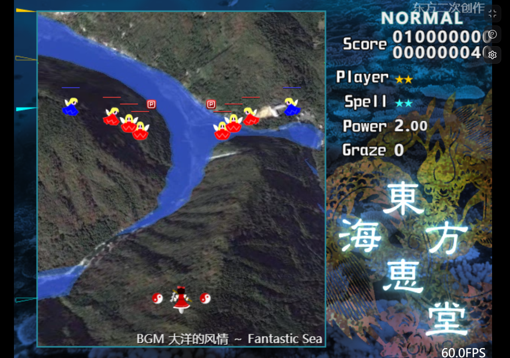

# 海惠堂单机接入验证

本次将海惠堂接入网页工程，完成作品登记、构建与资源配置、存档管理、打包完整性和文档接线。核心、生成显示源码与原始素材共 910 个文件逐字节保持迁入前内容，327 项原始素材沿用原修改时间。

## 本次检查

Windows x64 使用 Node.js 24.19.0、Bun 1.4.4、Emscripten 6.0.9 与 Edge 158.0.4370.45。重新编译游戏 WASM 和网站启动器，核对既有资源转换缓存后生成 301 项浏览器资源及 DATA。工具链可通过 EMSDK 指向已安装的 SDK，Python 依赖按本作固定要求安装。

| 检查 | 结果 |
| --- | --- |
| WASM、启动器构建及 TypeScript | 通过 |
| 三语检查 | 2643 条消息通过 |
| lint | 成功退出；上游现有警告保留 |
| 本作输入、录像与呈现测试 | 18/18 |
| 存档导入导出 | 25/25 |
| 源码打包与 Git 忽略规则 | 2/2 |
| 发布元数据相对路径 | 1/1 |
| 公共接口与源码检查 | 10/10 |
| 文档与索引 | 690 份文档通过 |
| 源码完整性 | 27 个核心调度文件完整纳入 |
| 正式浏览器默认呈现 | 标题、难度、开局、射击、暂停与恢复通过 |
| 正式浏览器高刷新呈现 | 设置刷新后保留；额外呈现期间逻辑约 60 Hz |

[默认呈现记录](browser-default.json)与[高刷新记录](browser-high-refresh.json)使用独立临时浏览器配置，从正常游戏卡片和启动按钮进入实际 WASM。高刷新检查在无头 Edge 中解除浏览器帧限制，用于验证额外绘制与逻辑步进分离。[汇总](result.json)保存本次源码身份和 WASM 哈希。

迁入前的完整录像、关卡、音频、触控和离线结果保存在相邻海惠堂归档目录，继续按各自原构建与验证范围读取。当前核心与数学行为未改动，既有数值验证按固定输入和依赖复用。

源码与素材来源见[导入说明](../../docs/migration/thkkd-file-import-20261126.md)，构建入口见[开发指南](../../ports/thkkd/docs/DEVELOPMENT.md)，完整文件清单见[本轮改动](CHANGES.md)。

