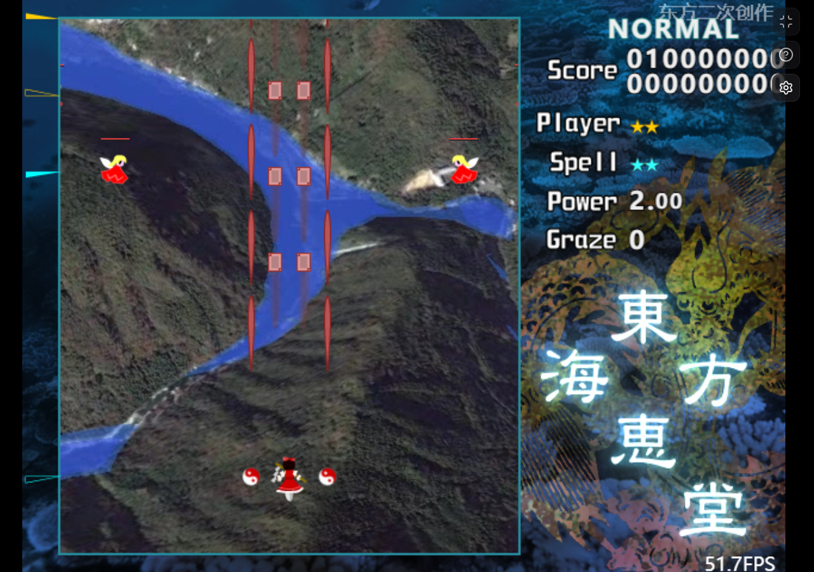

# 海惠堂原版资源导入

海惠堂以源码与资源分离的方式接入：Git 保存游戏代码、浏览器后台、构建脚本和资源哈希清单，327 项原版素材保留在本机。玩家导入根目录或同一层游戏目录中包含 `dat.dxa`、`bgm.dxa` 的 ZIP，浏览器校验并生成 301 项运行资源，图片与四段 WMV 在本机转换，MP3 和 WAV 使用原字节。

## 资源导出核对

核对的参照为[夏夜祭 PR 297](https://github.com/Ritosa2333/eagler-touhou/pull/297)、[鬼葬剑 PR 309](https://github.com/Ritosa2333/eagler-touhou/pull/309)、[BossRush PR 293](https://github.com/Ritosa2333/eagler-touhou/pull/293)及本仓库共用启动器。夏夜祭明确将本地 `content/` 与源码分开；鬼葬剑、BossRush 提供开发者准备导入包的脚本。共用网页界面提供资源导入、安装与清理，文件工具导出的是存档和 Replay。海惠堂采用相同的资源管理范围，资源入口只导入原版 ZIP。

## 实现与验证范围

原版导入使用独立的 DXA、图片与视频处理组件。海惠堂的两个导入调用入口均直接进入原版读取流程；旧网页 ZIP 的解析和生成接线已删除。站点构建不读取本机原素材，默认封面使用项目已有图标。源码包和 Git 忽略规则排除 `ports/thkkd/assets/` 与 `ports/thkkd/content/`，同时保留 `src/core/runtime/` 的核心代码。

核心与生成显示计算沿用此前基线，存档与 Replay 文件管理保持既有功能。测试使用独立浏览器配置与本机原版 ZIP，结果记录在本目录。

## 检查结果

Windows x64、Edge Edg/158.0.4370.45 下，原版 ZIP 导入、游戏首帧、301 项资源加载、四段视频的尺寸与时长、刷新复用和断网刷新全部通过。18 首 MP3 使用原始字节。242 张 PNG/BMP 的输出像素与 Pillow 参考结果完全一致，另 15 张 JPEG 通过实际浏览器解码。

原版导入单元检查 7/7，启动器导入、存档和安装回归 74/74，输入与 Replay 检查 18/18，源码包与忽略规则 2/2，项目公共接口 10/10；TypeScript 和三语消息检查通过。网站文件清单未包含 DXA、WMV、MP3 或游戏 DATA。

[结构化结果](result.json) · [改动文件](CHANGES.md)

## 来源历史接入方式

本次从主项目基线建立一个文件快照提交，旧开发仓库历史保留在本机。上游 `check-history.py --base upstream/main --changed-subtrees` 要求新增作品保留来源 Git 祖先，因此报告 `New port directories need retained source history: ports/thkkd`。来源说明已登记于 `docs/migration/thkkd-file-import-20261126.md`，文件快照接入方式需要在提交贡献时由维护者接受，现有检查脚本保持原规则。
