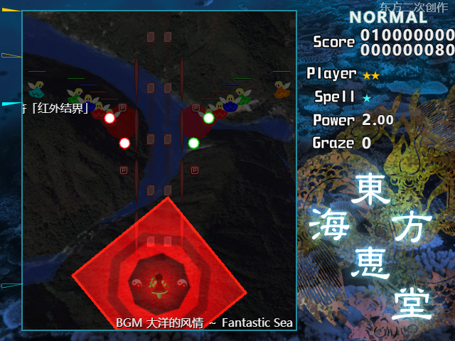

# 東方海恵堂绘制开销验证

网页使用固定 60 Hz 的游戏逻辑与独立呈现流程。本轮改动集中在 JavaScript 呈现器：整帧顶点一次上传、按原顺序绘制、复用批次与历史映射，并减少精灵角点计算的临时数组。C++ 核心、生成显示计算和 WASM 文件保持原字节。

## 检查结果

Windows x64、Edg/158.0.4370.45、NVIDIA GeForce RTX 4060 Ti 上，用合成原版格式录像覆盖九种机体的 27 个射击、Bomb 与后续场景。每个场景在插值参数 0、0.5、1 下的新旧像素完全相同，共 81 次对照；反复绘制后逻辑状态与命令快照保持一致。

1800 条混合绘制命令在七个插值参数下的实际 GPU 绘制状态与 Float32 顶点流完全相同，覆盖透明、加减混合、裁剪、透视、逐顶点颜色及插值边界。另核对 4800 条精灵命令与场景切换。输入、录像和呈现模块的 18 项检查通过。

## 性能结果

同一浏览器、同一场景交替运行新旧实现，计时前排空 GPU 队列。27 个场景的绘制提交耗时中位数从 0.082 ms 降至 0.044 ms，减少约 46%。每帧顶点上传从 33～79 次降到 1 次；绘制次数和绘制顺序保持一致。

每帧 1200 个精灵的命令准备测量从 0.956 ms 降至 0.399 ms，减少约 58%。该项测量包含角点、颜色、命令与前帧映射的准备工作。

[结构化结果](result.json) · [顶点与状态差分](vertex-differential.json) · [复现方法](../../ports/thkkd/docs/PERFORMANCE.md)

