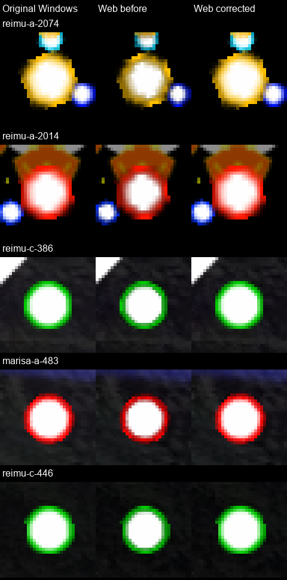
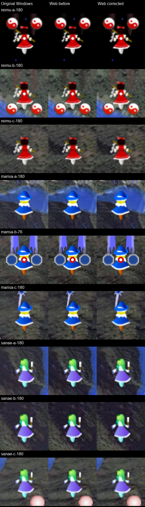

# 海惠堂网页显示对照

本轮针对 normal 网页 Runtime，按弹幕、自机与判定点、字体和背景的顺序检查原作画面。原程序为授权验证材料中的 Replay 系统 1.5，SHA-256 为 `ca568f1974946671dbba5a5be100a294d853d483dd0a05dccbea079930f00d6d`。复用已有九机体原作截图与同一份录像输入，并新增标题与字体创建调用采集；原程序测试副本使用副屏、静音和窗口模式，采集结束后退出，系统显示模式保持原值。

## 显示结果

原游戏当前配置 `10110` 选择 640×480、32 位全屏。网页固定 640×480 绘制缓冲区，并在保持桌面模式的浏览器中按 4:3 放大。原 `SetDrawMode(1)` 确认使用双线性过滤。本次修正 ImageBitmap 默认透明度预乘，恢复 RGB 与透明通道独立上传；原版索引、资源、坐标、旋转、裁剪及混合顺序继续沿用。

在 27 个同帧样本中，以实际绘制命令建立弹幕、自机、判定点与武器区域，排除 HUD、文字和场外区域。误差为区域中各 RGB 通道绝对差的平均值，范围 0–255。区域同时包含贴图透明部分背后的动态背景。

| 区域 | 纳入像素数 | 修改前平均差 | 修改后平均差 |
| --- | ---: | ---: | ---: |
| 敌弹 | 42,555 | 13.145576 | 0.653077 |
| 自机 | 70,227 | 4.558997 | 2.805298 |
| 判定点 | 726 | 2.212121 | 0.143251 |
| 自机武器与贴图特效 | 940,325 | 3.263267 | 2.045403 |

所有包含敌弹的统计样本均得到改善。黑色背景的灵梦 A 第 180 帧自机区域由 3.511214 降到 0.029732，97.92% 的区域像素与原作相同。九机体的自机、武器和 Bomb 画面已经实际查看。对照图按原作、修改前网页、修正后网页排列：

本机原程序最终 38 次 GDI 字体创建均使用微软雅黑。网页恢复原粗细分档、抗锯齿类型、描边字距与整数宽度布局；保留系统字体后备及随包 Unifont。主菜单 `Game Start` 的黄色前景误差由 31.074706 降到 12.902647，范围宽度从 127 恢复到 148 像素，原作宽 149 像素。

## 浏览器验收

实际使用 Windows 11、Edge 158.0.4370.33、NVIDIA RTX 4060 Ti / ANGLE D3D11。真实浏览器窗口放在副屏，原生 DPI 为 1.5，实际全屏中的游戏画面区域为 2048×1536，内部缓冲区仍为 640×480。另在 DevTools 设备模拟中覆盖 7 组尺寸与 DPI，包括 1、1.25、1.5、2、3 倍以及横竖屏。

- 18 个源 RGBA 样本与 GPU 纹理读回逐通道一致，纹理保持双线性采样。
- 27 个录像位置的游标、逻辑计时、随机数和选定自机及敌弹对象摘要与修改前一致。
- 标题、难度选择、实战和暂停的实际高刷新率呈现分别约 179.80、180.51、180.28、180.05 FPS，逻辑约 60 Hz。
- 120 次额外呈现保持逻辑、Replay 游标、原生呈现计数和音频播放实例序号不变。
- 正式 Runtime 通过视频纹理、BGM PCM、暂停恢复、九机体与关卡入口、原生改键及资源释放检查。
- 公共 WASD、自定义键位、手柄轴与按键、断开释放、触控移动与取消、横竖屏布局、放大镜、音量与全屏检查通过。
- 安装后断网重载，新的显示与字体模块随 Runtime 从 Service Worker 与本地资源存储恢复并进入首帧。

公共能力检查 10/10、扩展模块检查 18/18 通过；文档检查覆盖 692 份文档和 28 个源码目录，结果见[检查汇总](validation-summary.json)。源码打包同时收录本轮图片与机器结果，便于在本地交付中复核。

## 性能复测

每个采样窗口为 900 个逻辑步，默认限制 60 Hz 呈现。CPU 限速校准的实测耗时比为 4.19。EX 使用同一授权录像的 50120–51020 游标，两种 CPU 模式的起止对象摘要一致。

| 场景 | 正常 FPS | 正常逻辑 Hz | 4 倍限速 FPS | 4 倍限速逻辑 Hz |
| --- | ---: | ---: | ---: | ---: |
| 标题 | 60.03 | 60.03 | 59.29 | 60.30 |
| 实战第一面 | 59.94 | 60.00 | 6.68 | 60.16 |
| 密集 EX 录像 | 60.00 | 60.00 | 28.41 | 28.41 |

实战在限速下通过既有追帧循环维持逻辑频率；录像播放器按既有调度运行，密集片段的单步耗时约 21.50 ms。恢复的数学、碰撞、随机和回放规则保持原值。

## 代码与证据

独立 Windows 源码保持 `64d48dc366f2d57210dbdac25be82e0e71b2641d`。WASM SHA-256 继续为 `c842659b384e9492105ac7071e082c509d6f9c814b5d479e8c54e8445f4ca4dc`，DATA 为 `a76c17e91014722204467ff0602ed8eedc36402c360b8374eddfb3e66cf24635`。最终交付 Runtime 为 `ef20ada5e4e78ced7a8412f0da93a36b5b9f07176b2f011533212bc927440b8c`。

性能与同帧采集构建在整理文本换行之前完成，交付构建将 `platform.mjs` 统一为仓库的 LF；执行文件归一化摘要一致，最终交付构建另通过真实浏览器、DPI 与离线检查。[构建身份](build-identity.json)记录两次清单及归一化身份。[原程序调用](native-rendering.json)、[同帧状态](corpus.json)、[像素统计](comparison.json)、[菜单统计](menu-comparison.json)、[浏览器与离线](browser.json)、[高刷新率](high-refresh.json)、[系统检查](system.json)、[输入与公共功能](controls.json)和[性能数据](performance.json)保存实际结果。使用入口见[显示说明](../../ports/thkkd/docs/RENDERING.md)。

已有 60 用例、835289 逻辑步的核心迁移结果继续复用，本轮检查集中在实际变化的浏览器显示后台。共享渲染代码按作品同步规则迁入 MP 来源历史；这里的运行验收范围为 normal。[来源记录](history.json)保存普通版、MP 的提交与真实合并关系，以及原核心字节、用户工作区和远程配置的核对结果。
