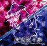
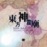
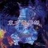
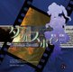
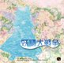
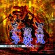

# 东方作品进度

表中按阶段记录进度，署名链接指向对应项目或维护者。各作功能验收见 [适配检查](adaptation/README.md)。

## Windows 正作

|  |  | 还原 | 移植 | Web 适配 | 多人联机 |
| :---: | :---: | :---: | :---: | :---: | :---: |
|  | **[th06] 東方紅魔郷 v1.02h** | [GensokyoClub](https://github.com/GensokyoClub/th06/tree/master) ![Done][done] | [GensokyoClub](https://github.com/GensokyoClub/th06/tree/portable) ![Done][done] | [Ritosa2333](https://github.com/Ritosa2333/th06/tree/eagler) ![Done][done] | [Ritosa2333](https://github.com/Ritosa2333/th06/tree/eagler) ![Done][done] |
|  | **[th07] 東方妖々夢 v1.00b** | [some100](https://github.com/some100/th07/tree/main) ![Done][done] | [some100](https://github.com/some100/th07/tree/reallyportable) ![Done][done] | [Ritosa2333](https://github.com/Ritosa2333/th07/tree/eagler) ![Done][done] | [Ritosa2333](https://github.com/Ritosa2333/th07/tree/eagler) ![Done][done] |
|  | **[th08] 東方永夜抄 v1.00d** | [SteinsGateON](https://github.com/Ritosa2333/th08/tree/main) ![Done][done] | [SteinsGateON](https://github.com/Ritosa2333/th08/tree/main) ![Done][done] | [Ritosa2333](https://github.com/Ritosa2333/th08/tree/eagler) ![Done][done] | [Ritosa2333](https://github.com/Ritosa2333/th08/tree/experiment/th08-multiplayer) ![Done][done] |
|  | **[th09] 東方花映塚 v1.50a** | [SteinsGateON](https://github.com/Ritosa2333/th09/tree/main) ![Done][done] | [SteinsGateON](https://github.com/Ritosa2333/th09/tree/main) ![Done][done] | [Ritosa2333](https://github.com/Ritosa2333/th09/tree/eagler) [![In Progress][in-progress-detail]](#th09-web-适配) | [Ritosa2333](https://github.com/Ritosa2333/th09/tree/experiment/th09-multiplayer) ![Done][done] |
|  | **[th10] 東方風神録 v1.00a** | [SteinsGateON](https://github.com/Ritosa2333/th10/tree/main) ![Done][done] | [SteinsGateON](https://github.com/Ritosa2333/th10/tree/portable) ![Done][done] | [Ritosa2333](https://github.com/Ritosa2333/th10/tree/eagler) ![Done][done] | [Ritosa2333](https://github.com/Ritosa2333/th10/tree/experiment/th10-multiplayer) ![Done][done] |
|  | **[th11] 東方地霊殿 v1.00a** | [SteinsGateON](https://github.com/Ritosa2333/th11/tree/main) ![Done][done] | [SteinsGateON](https://github.com/Ritosa2333/th11/tree/main) ![Done][done] | [Ritosa2333](https://github.com/Ritosa2333/th11/tree/eagler) [![In Progress][in-progress-detail]](#th11-web-适配) | [Ritosa2333](https://github.com/Ritosa2333/th11/tree/eagler) [![In Progress][in-progress-detail]](#th11-多人联机) |
|  | **[th12] 東方星蓮船 v1.00b** | [Tweet-META](https://github.com/Tweet-META/th12/tree/main) ![Done][done] | [Tweet-META](https://github.com/Goan114/eagler-touhou/tree/main/ports/th12) ![Done][done] | [Tweet-META](../ports/th12/README.md) [![In Progress][in-progress-detail]](../ports/th12/ADAPTATION.md) | - |
|  | **[th13] 東方神霊廟 v1.00c** | [AgentMystia](https://github.com/AgentMystia) ![In Progress][in-progress] | - | - | - |
|  | **[th14] 東方輝針城 v1.00b** | [AdingApkgg](https://github.com/AdingApkgg/thp) ![In Progress][in-progress] | [AdingApkgg](https://github.com/AdingApkgg/thp) ![In Progress][in-progress] | [AdingApkgg](https://github.com/AdingApkgg/thp) ![In Progress][in-progress] | - |
|  | **[th15] 東方紺珠伝 v1.00b** | [SteinsGateON](https://github.com/Ritosa2333/th15/tree/main) ![Done][done] | [SteinsGateON](https://github.com/Ritosa2333/th15/tree/main) ![Done][done] | [Ritosa2333](https://github.com/Ritosa2333/th15/tree/eagler) ![Done][done] | [Goan114](../ports/th15-mp/ADAPTATION.md) [![In Progress][in-progress-detail]](#th15-多人联机) |
|  | **[th16] 東方天空璋 v1.00a** | ![Unassigned][unassigned] | - | - | - |
|  | **[th17] 東方鬼形獣 v1.00b** | SteinsGateON ![In Progress][in-progress] | [Goan114](../ports/th17/README.md) ![In Progress][in-progress] | [Goan114](../ports/th17/ADAPTATION.md) ![In Progress][in-progress] | - |
|  | **[th18] 東方虹龍洞 v1.00a** | [owo-aya](https://github.com/owo-aya) ![In Progress][in-progress] | - | - | - |
|  | **[th19] 東方獣王園 v1.10c** | [Idle](https://github.com/Idle233333) ![In Progress][in-progress] | [Idle](https://github.com/Idle233333) ![In Progress][in-progress] | [Idle](https://github.com/Idle233333) ![In Progress][in-progress] | [Idle](https://github.com/Idle233333) ![In Progress][in-progress] |
|  | **[th20] 東方錦上京 v1.00c** | [Oracatt](https://github.com/Oracatt/Touhou20/tree/main) ![Done][done] | [Ritosa2333](https://github.com/Ritosa2333/eagler-touhou/tree/main/ports/th20) ![Done][done] | 搁置 | - |

## 旧作（PC-98）

th01–th05 的移植、Web 适配与多人项目由 [IxinorTyan](https://github.com/IxinorTyan) 开发。

th01 的原生 C++ 核心同时提供 Windows 与 Web 版本。
th02–th05 的独立项目以 DOSBox-X PC-98 核心提供浏览器单机、合作与联机。
[NP2 浏览器合集](https://github.com/IxinorTyan/touhou-np2)另提供五作的单机入口。

|  |  | 还原 | 移植 | Web 适配 | 多人联机 |
| :---: | :---: | :---: | :---: | :---: | :---: |
|  | **[th01] 東方靈異伝** | [nmlgc](https://github.com/nmlgc/ReC98/tree/master/th01) ![Done][done] | [IxinorTyan](https://github.com/IxinorTyan/th01-multiorb-lab) ![Done][done] | [IxinorTyan](https://github.com/IxinorTyan/th01-multiorb-lab) ![Done][done] | [IxinorTyan](https://github.com/IxinorTyan/th01-multiorb-lab) ![In Progress][in-progress] |
|  | **[th02] 東方封魔録** | [nmlgc](https://github.com/nmlgc/ReC98/tree/master/th02) ![In Progress][in-progress] | - | [IxinorTyan](https://github.com/IxinorTyan/th02-coop-lab) ![Done][done] | [IxinorTyan](https://github.com/IxinorTyan/th02-coop-lab) ![In Progress][in-progress] |
|  | **[th03] 東方夢時空** | [nmlgc](https://github.com/nmlgc/ReC98/tree/master/th03) ![In Progress][in-progress] | - | [IxinorTyan](https://github.com/IxinorTyan/th03-netplay-lab) ![Done][done] | [IxinorTyan](https://github.com/IxinorTyan/th03-netplay-lab) ![In Progress][in-progress] |
|  | **[th04] 東方幻想郷** | [nmlgc](https://github.com/nmlgc/ReC98/tree/master/th04) ![In Progress][in-progress] | - | [IxinorTyan](https://github.com/IxinorTyan/th04-coop-lab) ![Done][done] | [IxinorTyan](https://github.com/IxinorTyan/th04-coop-lab) ![In Progress][in-progress] |
|  | **[th05] 東方怪綺談** | [nmlgc](https://github.com/nmlgc/ReC98/tree/master/th05) ![In Progress][in-progress] | [Goan114](https://github.com/Goan114/uth05win-vibe) ![Done][done] | [Goan114](../ports/th05/README.md) ![In Progress][in-progress] | [IxinorTyan](https://github.com/IxinorTyan/th05-coop-lab) ![In Progress][in-progress] |

## 小数点作

|  |  | 还原 | 移植 | Web 适配 | 多人联机 |
| :---: | :---: | :---: | :---: | :---: | :---: |
|  | **[th075] 東方萃夢想** | [SteinsGateON](https://space.bilibili.com/34714121) ![Done][done] | [SteinsGateON](https://github.com/Ritosa2333/eagler-touhou/tree/main/ports/th075) ![Done][done] | [Goan114](https://github.com/Ritosa2333/eagler-touhou/tree/main/ports/th075) ![In Progress][in-progress] | [Goan114](https://github.com/Ritosa2333/eagler-touhou/tree/main/ports/th075-mp) ![In Progress][in-progress] |
|  | **[th095] 東方文花帖** | ![Unassigned][unassigned] | - | - | - |
|  | **[th105] 東方緋想天** | ![Unassigned][unassigned] | - | - | - |
|  | **[th123] 東方非想天則** | ![Unassigned][unassigned] | - | - | - |
|  | **[th125] ダブルスポイラー** | ![Unassigned][unassigned] | - | - | - |
|  | **[th128] 妖精大戦争** | ![Unassigned][unassigned] | - | - | - |
|  | **[th135] 東方心綺楼** | ![Unassigned][unassigned] | - | - | - |
|  | **[th143] 弾幕アマノジャク** | [Idle](https://github.com/Idle233333) ![In Progress][in-progress] | - | - | - |
|  | **[th145] 東方深秘録** | ![Unassigned][unassigned] | - | - | - |
|  | **[th155] 東方憑依華** | ![Unassigned][unassigned] | - | - | - |
|  | **[th165] 秘封ナイトメアダイアリー** | ![Unassigned][unassigned] | - | - | - |
|  | **[th175] 東方剛欲異聞** | ![Unassigned][unassigned] | - | - | - |
|  | **[th185] バレットフィリア達の闇市場** | ![Unassigned][unassigned] | - | - | - |

## 适配详情

## [th09] 東方花映塚 v1.50a

### th09 Web 适配

| 协议 | 高刷新率 | 触控 | 多语言 | thprac | Replay |
| :---: | :---: | :---: | :---: | :---: | :---: |
| ✅ | ❌ | ✅ | ✅ | ❌ | ✅ |

## [th11] 東方地霊殿 v1.00a

### th11 Web 适配

| 协议 | 高刷新率 | 触控 | 多语言 | thprac | Replay |
| :---: | :---: | :---: | :---: | :---: | :---: |
| ✅ | ❌ | ✅ | ✅ | ✅ | ✅ |

### th11 多人联机

| 规则 | 预测回滚 | 重开 | Replay | 旁观 |
| :---: | :---: | :---: | :---: | :---: |
| ✅ | ❌ | ✅ | ✅ | ✅ |

## [th14] 東方輝針城 v1.00b

独立 C++／SDL3／Wasm 实现进行中，整作1:1尚未完成。[当前游戏源码](https://github.com/AdingApkgg/thp/commit/572751a813eb58c874c901e20040b7674b1b8dcd)已部署到[TH14测试站](https://wth.saop.cc/)，[网站接入PR #233](https://github.com/Ritosa2333/eagler-touhou/pull/233)待上游合入。原作DATA、FLAC音乐与不可变Runtime分开提供。

最新修正文字队列坐标和对齐顺序：先按原版缩放起始XYZ、添加pass1原点，再执行居中／靠右／垂直对齐；HUD分数和奖励文字保留对齐信息到这个阶段。[原版队列40b9b0与文字40bf20串联对照](https://github.com/AdingApkgg/thp/blob/6e8dcbb4ce667718d9af3971080728d7a7739498/docs/porting/TH14_ASCII_QUEUE_LAYOUT_NOV12.md)覆盖六个宽度、六种字体、三种字形缩放、阴影、两段文字、三个通道和五种对齐组合，共6,480组／160,380字形／962,280字完全一致。旧API只支持其中1,296组左／顶部样例，1,152组失败；未把另5,184组计作旧版通过。两条真实HUD文字生产路径另有48组侧栏及144组奖励／时间样例，共4,372字形／21,860字全部相同，旧版160组失败。CRT、图集、几何和GPU仍为声明的服务边界；队列在稳定显示尺寸下延迟转换坐标，不宣称中途换分辨率、真实图集几何或像素通过。

TH14文字样式布局改变，因此重新编译全部141个游戏单元、146个浏览器单元和用于Application检查的4个宿主单元。TH12／13／16的文本和HUD对象共六对逐字节不变。一次静音真实Application／GLES检查完成启动、标题、普通Quit和保存：400个宿主帧、0个Player回调；线程、GPU、计时器和时钟全部回收。分数档21,633字节、配置92字节与同输入旧C++样例完全一致；解码149,076字节分数的八条记录校验通过，音乐／音效均为0。这不替代原版同触发Quit、当前浏览器持久化、整局流程或最终PCM验收。

此前type0实际批次提交／混合缓存修正的360组／161,406字、普通精灵及ASCII查询后提交各13,824组／165,888坐标字，以及mode8两条路线各4,608组矩阵对照，保留各自有限范围。已有修正还包括初次Control在Overlay8后的发布、工作线程复用暂停菜单、Control／演示时钟及提前返回和正常Quit保存同步。原版分数／配置导入后可由C++正常Quit逐字节保留，原版编解码器也可往返当前新存档；这些不视为完整浏览器持久化通过。

[当前发布记录](https://github.com/AdingApkgg/thp/blob/main/docs/porting/th14-camera-right-release-nov12.json)：代次`4df167f1d7279ce829ac1ff6636e6540948a92731aad0429d57b24d53d564ac7`，Wasm SHA-256 `9b17c2e2bfe2e19a63af3b6d2c7d0ba6082ca05f24bef858ab51f85d65e022b4`。GitHub上368个构建源码文件与构建时字节相同；源站39个Runtime文件哈希相符，公网核对新Wasm、加载器、shell、清单和HTML共5个正文及COOP／COEP／no-transform。其余未改公网正文未重复下载，之前完整公网校验保持单独范围。e6b15d27旧版经TS Arch服务SSH转发的浏览器验收覆盖Normal灵梦B开局／射击／Bomb、暂停恢复、标题及Quit；当前Chrome连接仍未附加调试，未取得新浏览器UI验收，未要求用户手动恢复。

加载／动画RNG仍是首要剩余项。[保留506b9da9实测的交接审计](https://github.com/AdingApkgg/thp/blob/6e8dcbb4ce667718d9af3971080728d7a7739498/docs/porting/th14-loading-enable-boundary-nov12.json)显示47个相同原始root／age／counter节点的SCRIPT种子和次数完全一致；在age79时RNG仍同，C++已启用Control而原版到age84才启用。24次差异在各自首个Player之前已存在，双方之后各消耗20次。三个原版403310轨道检查精确复现端点；这不是实际调用者／抢占轨迹证明，21／20粒子只与一次额外出生相符，物理完成时序仍未接受。该旧实测首帧仍差281,902像素／3,036个Alpha字节；本次没有重跑Player或继承其通过范围，也未固定补帧／随机调用或反馈原版状态。全部自机／难度、完整录像、相机缓存、整局图像、普通完整流程／存档和最终PCM继续验收。

补充真实图集和绘制路径对照：[648组图集绑定／顶点／有效状态检查](https://github.com/AdingApkgg/thp/blob/c6d907d22c9fdaf74d6fe13f19cc82d04bf53e63/docs/porting/TH14_ASCII_ATLAS_GEOMETRY_NOV12.md)执行原版真实ASCII资源加载、VM绑定、队列、几何和实际批次flush，覆盖640／960／1280宽度、六字体、两缩放、阴影、三通道和三对齐组合；31,392个提交顶点、941,760字的有效状态／顶点对照一致，提交次数全部相同。原始状态检查仍保留31,392字失败：原版纹理变换标志2而C++为0；仅在D3D规定忽略纹理变换的XYZRHW顶点上另行比较有效语义，未宣称原始状态逐字相同。世界坐标／UV／混合因子的负对照生效。未改游戏源码、未重复部署或运行游戏／GPU；图像、加载时序、浏览器及整作仍未验收。当前公网th14.html重新核对506字节及清单哈希相同，保留no-transform。

补充真实像素对照：[18组ASCII离屏光栅检查](https://github.com/AdingApkgg/thp/blob/ac8a7dd3cdb829f64e040e44a571dbe9add77397/docs/porting/TH14_ASCII_ATLAS_RASTER_NOV12.md)将原版真实几何和原始ARGB4444纹理交给独立D3D9 HAL，与当前C++真实资源解析／文字／GraphicsDevice／Renderer在ANGLE/GLES上的输出比较。640／960／1280三宽度、字体0／4和三个通道的18组全部像素一致；总目标13,363,200像素，其中5,403像素非背景。测试明确关闭fog／depth，使用Z0、0.7／0.3缩放、阴影和左顶部对齐；不代表全部字形组合或整局图像。首轮原版夹具漏传初始viewport，失败314像素；补上原版空队列真实camera上传后，仅viewport记录改变，失败参考保留。复用同一次C++GPU运行的16组原有精确结果及另外2组保留图像逐字节比对，没有为修正参考重跑C++。各GPU对象和隐藏窗口已回收，全程静音，未启动原版游戏／完整录像、未改源码或重新部署。加载RNG／物理时序、相机缓存、全部模式、浏览器和整作继续验收。

共享相机right发布修正：[原版8／4／4／4／4字节写入协议](https://github.com/AdingApkgg/thp/blob/572751a813eb58c874c901e20040b7674b1b8dcd/docs/porting/TH14_CAMERA_RIGHT_PUBLICATION_NOV12.md)现在由共享world相机的对齐64位XY发布、标量Z以及归一化XYZ三笔32位发布保持。旧优化SDK对象将原始Y／X拆成两笔写入；当前SDK和浏览器对象均核对了实际生成指令。world相机所有者保证8字节对齐，SceneCamera保持300字节，SceneCompositor实测尺寸不变；其他未对齐私有相机的普通qword回退不宣称原子性，也未把75个独立读取改成整相机快照。TH12／13／16及TH14无worker的相机／compositor共八对对象逐字节相同。40组真实原版宿主数学／40组FOV负对照，以及80组对齐／未对齐阶段观察例全部保持75字最终结果。全部141个游戏、4个宿主及146个正常浏览器单元重新编译，368个发布源码字节与构建来源相同。

一次静音真实C++Application／GLES冷启动在508个宿主帧后到达第一个灵梦B Normal Player画面（1个Player回调），实际共享right对齐正确；四个逻辑回调、两个物理worker宿主及GPU／计时器／时钟全部回收。对保留原版参考的严格比较仍差194,896像素／3,092个Alpha字节，SCRIPT仍差24次；各次物理加载时间不同，不能把该图像数量与旧版本的差距归因于这项修正，也未证明旧缓存矩阵差异的全部原因。当前发布代次、Wasm和39源站／5公网正文核验见上方发布记录，COOP／COEP／no-transform保持；当前浏览器UI／持久化、加载时序、整帧、全部模式／完整录像、完整普通流程／存档和最终PCM仍未完成。

原版相机角色校正：[实际reset参数及Stage复制／绘制指令](https://github.com/AdingApkgg/thp/blob/bd2f4d966e2e82a0e16dc98d4898c3ade83d4178/docs/porting/TH14_CAMERA_ROLES_NOV12.md)确认full=`0x4d93e8`、play=`0x4d9190`、scaled=`0x4d92bc`、world=`0x4d9514`。此前将`0x4d9190`写成world并称其原始XY自然8字节对齐的说明错误，已更正并保留原记录；实际world的XY在`0x4d9544`，非自然8字节对齐，但落在同一实测64字节缓存行内。原子性依据明确限定普通缓存映射下P6及后续CPU的缓存行内非对齐访问规则，未实测历史页保护；不能从Unicorn写钩子推导硬件原子性。C++的world角色及8字节对齐实现不变，仅校正误导性注释，SDK／浏览器compositor对象逐字节相同，其他对象未重复编译。当前运行包仍为`572751a8`／Wasm`9b17c2e2…`，本次未重新部署、未启动游戏或GPU，也未新增验收模式。新浏览器页已创建并被inventory确认，但Chrome仍未附加调试器，未进行游戏UI输入或要求人工恢复；24次RNG差异及完整图像／流程等未完成项继续保留。

## [th15] 東方紺珠伝 v1.00b

### th15 多人联机

| 规则 | 预测回滚 | 重开 | Replay | 旁观 |
| :---: | :---: | :---: | :---: | :---: |
| ❌ | ❌ | ❌ | ❌ | ❌ |

## 能力表样例

### Web 适配

| 协议 | 高刷新率 | 触控 | 多语言 | thprac | Replay |
| :---: | :---: | :---: | :---: | :---: | :---: |
| ✅ | ✅ | ✅ | ✅ | ✅ | ✅ |

### 多人联机

| 规则 | 预测回滚 | 重开 | Replay | 旁观 |
| :---: | :---: | :---: | :---: | :---: |
| ✅ | ✅ | ✅ | ✅ | ✅ |

## 图片来源

[THBWiki / 图片来源记录](../launcher/docs/assets/game-covers/sources.json)

[done]: https://img.shields.io/badge/Done-2ea44f?style=flat-square
[in-progress]: https://img.shields.io/badge/In%20Progress-f59e0b?style=flat-square
[in-progress-detail]: https://img.shields.io/badge/In%20Progress%20%28Click%20for%20detail%29-f59e0b?style=flat-square
[unassigned]: https://img.shields.io/badge/Unassigned-808080?style=flat-square
