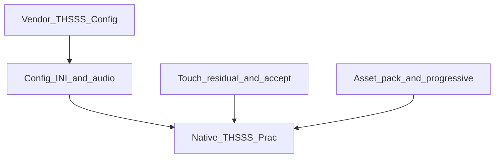

# THSSS-WASM 适配收口（README 路线图 + Prac）

## 范围

- **做**：Config 接入、触控 th06 收尾、资源打包/加载优化、THSSS-Prac（对标 PRACTICE-01..08 + 上游诚实子集）
- **其他改动**：把 [THSSS-Config](../THSSS-Config/) 迁入 `vendor/THSSS-Config/`（与 `vendor/THSSS-src/`、`vendor/THSSS.exe` 同级，仍不参与浏览器构建）
- **不做**：联机 / MP、清 `testOnly` / 默认可见、子树迁入 `ports/thsss`、全文 ADAPTATION（BUILD→VERIFY）
- **源码家**：继续本仓库 sibling；eagler 只改 catalog / 协议接线 / Prac 文档
- **适配文档总入口**：[docs/adaptation/README.md](../../eagler-touhou/docs/adaptation/README.md)；验收记录模板 [record-template.md](../../eagler-touhou/docs/adaptation/record-template.md)

## 0. 其他改动：THSSS-Config 迁入 vendor

将根目录 dnSpy 导出的配置器与游戏基线同源归档，避免与可构建模块并列。

**适配文档引用**

- 源码与素材出处登记：[BUILD-06](../../eagler-touhou/docs/adaptation/build.md#build-06)
- 仓库模块约定：[AGENTS.md](../AGENTS.md)（Game SSOT / vendor）、[README 模块表](../README.md)

**本轮动作**

1. `git mv THSSS-Config vendor/THSSS-Config`（保留 `Config.sln` / `Config/` 内部结构）
2. 更新 [README.md](../README.md) / [README.en.md](../README.en.md) 模块表与「配置器用 …」路径为 `vendor/THSSS-Config/Config.sln`
3. 若 [AGENTS.md](../AGENTS.md) 或其它文档仍写旧路径，一并改为 `vendor/THSSS-Config/`
4. 确认浏览器解决方案 [THSSS.sln](../THSSS.sln) 与构建脚本不引用该目录（现状应无引用）
5. 单独提交：`chore(vendor): move THSSS-Config under vendor`

迁入后，§1 Config 接入仍以 `vendor/THSSS-Config/Config/Form_Config.cs` 为键目录，不移植 WinForms。

## 0b. 文档与路线图同步

- 更新 [README.md](../README.md) / [README.en.md](../README.en.md) 路线图：联机标为以后；其余四项进入本轮
- 将 [touch-th01-parity.plan.md](touch-th01-parity.plan.md) 标为历史（frontmatter 不再当待办）
- 触控基准继续以 [touch-th06.plan.md](touch-th06.plan.md) 为准
- 流程对照：[适配流程 §3 逐项适配](../../eagler-touhou/docs/adaptation/README.md)（本轮只开本 plan 涉及的检查编号，不要求全文建表）

## 1. Config 接入（不移植 WinForms）

以 [vendor/THSSS-Config/Config/Form_Config.cs](../vendor/THSSS-Config/Config/Form_Config.cs)（迁入后路径）为键目录，不移植 UI。

**适配文档引用**

- 启动链：[RUNTIME-02](../../eagler-touhou/docs/adaptation/runtime.md#runtime-02)（`ready → configure → launch → first-frame`）、[RUNTIME-03](../../eagler-touhou/docs/adaptation/runtime.md#runtime-03)（配置命令响应）
- 配置文件与持久化：[SAVE-01](../../eagler-touhou/docs/adaptation/storage.md#save-01)（`Setting.INI` 已在 catalog 声明）、[SAVE-02](../../eagler-touhou/docs/adaptation/storage.md#save-02)、[SAVE-03](../../eagler-touhou/docs/adaptation/storage.md#save-03)、[SAVE-04](../../eagler-touhou/docs/adaptation/storage.md#save-04)
- 音量与输出：[AUDIO-01](../../eagler-touhou/docs/adaptation/presentation.md#audio-01)、[AUDIO-02](../../eagler-touhou/docs/adaptation/presentation.md#audio-02)；启动器独立 BGM/SE 音量见 [presentation.md 声音验收方法](../../eagler-touhou/docs/adaptation/presentation.md)
- 高刷限制开关：[DISPLAY-08](../../eagler-touhou/docs/adaptation/presentation.md#display-08)（`UnlockFPS` / `limitPresentationTo60`）
- 键位改键（若写入 INI）：[INPUT-02](../../eagler-touhou/docs/adaptation/input.md#input-02)

**写入面**（`shell.mjs` 在 `launchRuntime` / `_thsss_start` 之前）：

- 从 [ContentLoader.DefaultIni](../THSSS.Browser/ContentLoader.cs) 起步，合并 `configure` 的 `options`
- `bgmVolume` / `sfxVolume` → `Volume.BGMVolume` / `SEVolume`
- `limitPresentationTo60 === false` → `Mode.UnlockFPS=1`（已有 [GameHost](../THSSS.Browser/GameHost.cs) 读取）
- 可选键位 / `Game.FontType` 覆盖写入 `Setting.INI`，经现有 `files.mjs` / VFS + `OverlaySaves` 路径让 `Game_Main` 读到

**忽略（Web 无意义）**：`FullWindow`、`AntiAlias`、`VerticalSync`、`UseDirectInput`、`JoyStick.*`、`PresentInterval` 暴露

**实时音量**：在 [wwwroot/audio.js](../THSSS.Browser/wwwroot/audio.js) 实现 `Module.eaglerSetAudioLevels(music, effects)`，区分 BGM / SE gain，对接启动器 `setAudioLevels`

## 2. 触控收尾（th06）

多数行为已在 `touch-bridge.mjs` / `touch-movement.mjs` 与 patches `003`/`004`/`006`。本轮只补缺口并按适配表验收。

**适配文档引用**

- 限速滑动与余量：[TOUCH-01](../../eagler-touhou/docs/adaptation/input.md#touch-01)（「拖动距离保留」= 墙边 / 速度上限后的 residual）
- 无限速与落率：[TOUCH-02](../../eagler-touhou/docs/adaptation/input.md#touch-02)、[TOUCH-10](../../eagler-touhou/docs/adaptation/input.md#touch-10)
- 摇杆模式：[TOUCH-03](../../eagler-touhou/docs/adaptation/input.md#touch-03)、[TOUCH-04](../../eagler-touhou/docs/adaptation/input.md#touch-04)
- 禁移连续性：[TOUCH-09](../../eagler-touhou/docs/adaptation/input.md#touch-09)
- 触控扩展 Replay：[REPLAY-03](../../eagler-touhou/docs/adaptation/storage.md#replay-03)、[REPLAY-04](../../eagler-touhou/docs/adaptation/storage.md#replay-04)（`.trpy`）
- 本作触控行为说明：[touch-th06.plan.md](touch-th06.plan.md)；检查表全文：[input.md](../../eagler-touhou/docs/adaptation/input.md)

**本轮动作**

1. **墙边未消费余量**：`BaseMyPlane.ApplyTouch` / `Game_Main.TouchShift` 回报 clamp 后 residual；`touch-bridge.presented()` restore 未走出分量（对齐 TOUCH-01 / th06「只消费实际走出」）
2. **测试**：现有 [THSSS.Browser/tests/input/](../THSSS.Browser/tests/input/) 加 residual / 墙边用例
3. **本地验收清单**（写进 `ports/thsss/README.md`）：至少覆盖 TOUCH-01/02/03/04/09/10 与 `.trpy` 往返；**不**清 `testOnly`
4. 明确不做：决死 +5 帧、启动器 SlowRate UI

## 3. 资源加载与体积

保持 THDAT v1，不做新容器。

**适配文档引用**

- 资源分工与挂载：[RUNTIME-05](../../eagler-touhou/docs/adaptation/runtime.md#runtime-05)、[PACKAGE-02](../../eagler-touhou/docs/adaptation/runtime.md#package-02)、[PACKAGE-05](../../eagler-touhou/docs/adaptation/runtime.md#package-05)
- 首帧与资源就绪：[DISPLAY-07](../../eagler-touhou/docs/adaptation/presentation.md#display-07)、[RUNTIME-02](../../eagler-touhou/docs/adaptation/runtime.md#runtime-02)
- OGG 音乐与音效不阻塞：[AUDIO-01](../../eagler-touhou/docs/adaptation/presentation.md#audio-01)、[AUDIO-07](../../eagler-touhou/docs/adaptation/presentation.md#audio-07)
- 用户数据与游戏包分离（重打 `thsss.dat` 后存档仍在）：[SAVE-06](../../eagler-touhou/docs/adaptation/storage.md#save-06)
- 检查表：[runtime.md](../../eagler-touhou/docs/adaptation/runtime.md)、[presentation.md](../../eagler-touhou/docs/adaptation/presentation.md)

**本轮动作**

1. **[tools/StageContent](../tools/StageContent/Program.cs)**：`Sound/` 若存在同名 `.ogg` 则不打包 `.wav`（运行时 [SourceVoice](../THSSS.SlimDX/XAudio2/SourceVoice.cs) 已 remap）
2. **[ContentLoader](../THSSS.Browser/ContentLoader.cs)**：优先解包开场 / 菜单 `Image/`；用已有 `IsFileReady` / `readyFiles` 卡住 `TexturePump`；`BackgroundIdle` 在残留条目完成前为 false
3. BGM 继续松散文件；可选后续只对 HTTP 载荷 gzip，本轮不改格式

## 4. THSSS-Prac（原生 session，对标文档）

**模型**：eagler **native session**（`thpracRuntime: { session: "native" }`），不把 THSSS 塞进 [launcher/integrations/thprac.mjs](../../eagler-touhou/launcher/integrations/thprac.mjs) Windows 参数表。

**适配文档引用（逐项）**

| 本轮动作 | 适配编号 |
| --- | --- |
| catalog / manifest / Release 一致声明 thprac | [PRACTICE-01](../../eagler-touhou/docs/adaptation/localization.md#practice-01) |
| `configure` 传入 `thpracEnabled` + `thpracLocale` | [PRACTICE-02](../../eagler-touhou/docs/adaptation/localization.md#practice-02) |
| Practice / Restart / Replay / 普通 Start 由 Runtime 自管状态 | [PRACTICE-03](../../eagler-touhou/docs/adaptation/localization.md#practice-03) |
| 章节/符卡跳转、资源初值等界面参数真实生效 | [PRACTICE-04](../../eagler-touhou/docs/adaptation/localization.md#practice-04) |
| 练习参数写入 `.rpy`/`.trpy`（无 sidecar） | [PRACTICE-05](../../eagler-touhou/docs/adaptation/localization.md#practice-05)、[REPLAY-04](../../eagler-touhou/docs/adaptation/storage.md#replay-04) |
| `thprac-mouse` + 触控功能键 | [PRACTICE-06](../../eagler-touhou/docs/adaptation/localization.md#practice-06) |
| 启动器语言 → 练习 UI 语言/字体 | [PRACTICE-07](../../eagler-touhou/docs/adaptation/localization.md#practice-07) |
| UI 只露出已实现能力（诚实子集） | [PRACTICE-08](../../eagler-touhou/docs/adaptation/localization.md#practice-08) |

检查表与接口：[localization.md](../../eagler-touhou/docs/adaptation/localization.md)、[RUNTIME_CONTRACT.md](../../eagler-touhou/launcher/integrations/RUNTIME_CONTRACT.md)、流程 [README §4 适配表](../../eagler-touhou/docs/adaptation/README.md)

**诚实基线**：上游 [RUEEE/ShiningShootingStar_Prac](https://github.com/RUEEE/ShiningShootingStar_Prac)。本轮功能子集：

- Backspace 工具菜单：F1 无敌、F2 禁用 X、F3 失焦不暂停
- 章节 / 符卡练习跳转（含 Extra 若上游有）
- 开局资源初值（与界面声明一致的部分）
- 练习状态由 Runtime 自管；练习参数写入 Replay；`thprac-mouse` + 触控功能键；关掉 shell 里的 `rejectInapplicable`

**不做本轮**：F12 高级面板全量、分辨率 hack、未在上游完成的功能、假 UI、联机

**实现落点（本仓库）**

- 新模块组（按 AGENTS：单责分目录），宿主桥 + `patches/` 游戏内练习 UI / 状态
- [manifest.json](../THSSS.Browser/wwwroot/manifest.json) `features.thprac: true`
- [stage-eagler-runtime.mjs](../THSSS.Browser/stage-eagler-runtime.mjs) 允许 attestation 为 true
- [shell.mjs](../THSSS.Browser/wwwroot/shell.mjs) 接受 configure 练习选项与 `thprac-mouse`

**eagler 对标文档（最小）**

- [product-catalog.mjs](../../eagler-touhou/common/contracts/product-catalog.mjs) `thsss`：`features.thprac: true`，`thpracRuntime: { session: "native" }`；**保持** `testOnly` / `buildOptIn`
- 新增 [ports/thsss/PRACTICE.md](../../eagler-touhou/ports/thsss/PRACTICE.md)：功能表、键位、Replay 元数据、与上游差异
- 新增 [ports/thsss/ADAPTATION.md](../../eagler-touhou/ports/thsss/ADAPTATION.md) **仅**「语言与练习」PRACTICE-01..08 表（链到 localization.md）；其它章节本轮不开全文
- [ports/thsss/README.md](../../eagler-touhou/ports/thsss/README.md) 链到 PRACTICE / ADAPTATION；`thpracEnabled=false` 时原版 StageSelect 仍可用
- 验收证据按 [record-template.md](../../eagler-touhou/docs/adaptation/record-template.md) 写入 ADAPTATION「运行验收记录」

## 5. 验收顺序

0. Vendor：`vendor/THSSS-Config/` 存在；README／AGENTS 路径更新；浏览器构建仍不编译该树 → BUILD-06
1. Config：冷启动 INI 含音量 / UnlockFPS；启动器滑条实时改 BGM/SE → RUNTIME-02、SAVE-01/03/04、AUDIO、DISPLAY-08
2. Touch：墙边 residual 单测 + README 清单手测 → TOUCH-01/02/03/04/09/10、REPLAY-04
3. Assets：新 `thsss.dat` 无双格式 Sound；开场贴图在全量解包完成前可显示 → PACKAGE-02、RUNTIME-05、DISPLAY-07、AUDIO-07、SAVE-06
4. Prac：PRACTICE-01..08 按 [localization.md](../../eagler-touhou/docs/adaptation/localization.md) 走一遍
5. 回归：无 Prac 普通局、`.rpy` / `.trpy`、存档 IndexedDB → REPLAY-02/04、SAVE-04

## 主要改动文件

- 本仓库（其他改动）：`THSSS-Config/` → `vendor/THSSS-Config/`；README／README.en／AGENTS 路径
- 本仓库（适配）：`shell.mjs`, `audio.js`, `ContentLoader.cs`, `StageContent`, `touch-bridge.mjs`, touch patches, Prac 模块 + patches, `manifest.json`, README 路线图
- eagler-touhou：`product-catalog.mjs`, `ports/thsss/{README,PRACTICE,ADAPTATION}.md`
