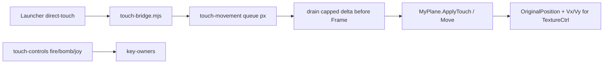
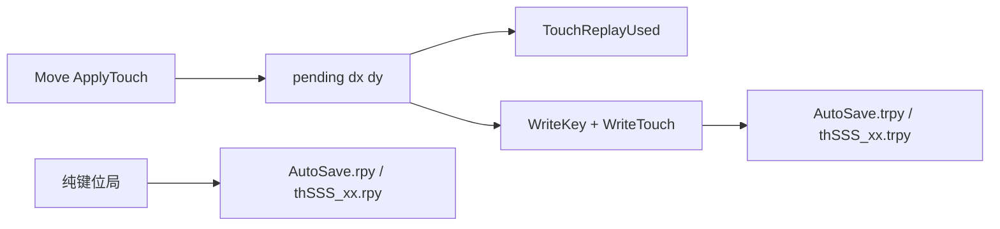

# THSSS 触控对标 th01

本文件是历史实现记录。当前触控基准是 [touch-th06.plan.md](touch-th06.plan.md)，下面的条目不再作为待办。

## 目标行为（对标 th01）



- **玩法直触（`touch` / `touch-unlimited`）**：手指归一化位移 × 灵敏度 → 像素队列；每逻辑帧按 `HighSpeed`/`LowSpeed`（斜向 ×0.71）取出一步，直接改机体坐标，**不再**把直触写成 `Left/Right/Up/Down`。
- **无限速**：整段队列一次交给 Apply 入口（现有 `TouchShift` / `ShiftBy` 路径），与限速共用。
- **抬手**：primary 抬起时清空队列并停止位移（对齐 [ports/th01/web/direct-drag.js](ports/th01/web/direct-drag.js)）；手指仍按住时保留未走完的距离（对齐适配表「拖动距离保留」的在按含义）。
- **第二指低速 / HUD 射击 Bomb / 菜单手势**：继续走现有 `key-owners` + `menu-gestures`。
- **虚拟摇杆**：启动器已下发连续轴 `joystickX/Y ∈ [-32767,32767]`（见 [player-joystick.ts](eagler-touhou/launcher/app/services/player-joystick.ts)）。本计划**不再**把轴压成方向键；经同一 `ApplyTouch` / `Move` patch 吃模拟量。`joystick` 在 JS 侧 quantize 成 8 向单位向量再 × 原速；`joystick-free` 保留连续方向与推杆幅度（TOUCH-03 / TOUCH-04）。
- **Replay 分流**：纯键盘局继续 `.rpy`；**一旦本局用过触控位移（ApplyTouch 非零或触控移动模式实际生效）则录成 `.trpy`**，与原作带从文件名上区分，避免污染桌面原版播放器。

## 实现步骤

### 1. 位移队列改为产出像素步进

改 [THSSS.Browser/wwwroot/host/input/touch-movement.mjs](THSSS.Browser/wwwroot/host/input/touch-movement.mjs)：

- `drain({ focus })` 对限速返回 `{ shiftX, shiftY }`（长度 ≤ 本帧原速，斜向已乘 0.71），不再返回方向布尔。
- `unlimited` 仍一次倒空为 `shiftX/shiftY`。
- 保留 `add` / `clear` / `queued`；默认灵敏度在 bridge 侧与启动器/th01 对齐为 **150**（未配置时）。

### 2. Bridge：直触与摇杆都走 Shift，不占方向键

改 [THSSS.Browser/wwwroot/host/input/touch-bridge.mjs](THSSS.Browser/wwwroot/host/input/touch-bridge.mjs)：

- `presented()`：
  - `touch` / `touch-unlimited`：`drain` → `shift(dx,dy)`。
  - `joystick` / `joystick-free`：用最近一次 `touch-controls` 的轴算本帧位移 → `shift`；**删除** `applyJoystick` → `setKey(Left/…)`。
  - 轴归一化：`nx = joystickX/32767`，`ny = joystickY/32767`，`mag = hypot(nx,ny)`（启动器已做径向死区）。
  - `joystick-free`：`dx = nx * speed`，`dy` 同理；`speed` 取 `HighSpeed`/`LowSpeed`（由 focus）。
  - `joystick`：角度 quantize 到 8 向后再 × `speed`（斜向 ×0.71）。
- `direct()` primary `up`：`movement.clear()`。
- `touch-fire` / `touch-focus` / `touch-second` / 菜单 pulse 不变。

### 3. 位移必须进 `Move` 时序（patch）

- 帧前钩子：每逻辑帧「先 drain/stick → ApplyTouch，再 MainProcess」。
- 扩展 [patches/003-frame-touch-host.patch](patches/003-frame-touch-host.patch)：
  - `ApplyTouch(dx,dy)` 记下本帧待应用位移。
  - `Move()`：有触控位移则更新坐标并设 `Vx = dx`、`Vy = -dy`；不读方向键。
  - 无触控时保持原方向键 `Move`。
  - `Time <= 70` 强制归位段忽略触控；并置 `TouchReplayUsed`（或等价）供存档选扩展名。

### 4. 触控 Replay 用 `.trpy`，不用 `.rpy`

现状：每帧 [BaseStage](THSSS/Shooting/BaseStage.cs) `WriteKey(Key2Hex())` 仅 **2 字节**键位；`ApplyTouch` 不进带。



**THSSS-WASM 可做**

- **扩展名分流**：本局若出现过触控位移（或配置为触控移动局且实际写过非零 delta），`CreatRpy` / `SaveRpy` / 自动存使用 `Replay/AutoSave.trpy`、`Replay/thSSS_XX.trpy`；纯键位仍 `.rpy`。
- **`.trpy` 载荷**（不塞进 `.rpy`）：
  - 关卡标记 `57358`、结束 `4080`：仍 2 字节。
  - 普通帧：`uint16 keys` + `int16 dx` + `int16 dy` = 6 字节。
  - 尾部 `ReplayInfo` 含 `TouchDelta=1`（或文件头魔数），加载 `.trpy` 时走 6 字节读路径。
- 补丁：[Replay.cs](THSSS/Shooting/Replay.cs)、[BaseStage.cs](THSSS/Shooting/BaseStage.cs)、存读菜单 [MenuGroup_ReplaySaver](THSSS/Shooting/MenuGroup_ReplaySaver.cs) / [Loader](THSSS/Shooting/MenuGroup_ReplayLoader.cs) / [Namer](THSSS/Shooting/MenuGroup_ReplayNamer.cs)：列表同时扫 `.rpy` 与 `.trpy`；保存名带对扩展名。
- 回放 `.trpy`：`ReadKey` + `ReadTouch` → `Hex2Key` + `ApplyTouch`；`OnReplay` 忽略 live 触控。
- 回放 `.rpy`：行为与原作一致，无 touch 字段。

**验收（WASM 内）**：触控局落盘为 `.trpy` 且回放轨迹一致；键位局仍是 `.rpy`；用桌面原版打开 `.trpy` 预期失败或不当作合法 `.rpy`（正是分流目的）。

### 4b. Addon（多半不在 THSSS-WASM 独力完成）— eagler-touhou / 启动器

下列项写入计划作 **跨仓 addon**，本轮实现触控与 `.trpy` 编解码时在 WASM 侧预留文件名；启动器接线可同 PR 或后续跟进：

| 位置 | 需要 |
| --- | --- |
| [THSSS.Browser/wwwroot/host/storage/files.mjs](THSSS.Browser/wwwroot/host/storage/files.mjs) | 白名单增加 `thSSS_*.trpy`、`AutoSave.trpy`（与现有 `.rpy` 并列），否则 IndexedDB/list/write 会拒文件。 |
| eagler-touhou 存档/Replay UI | 若按扩展名过滤「可导入/导出 Replay」，需承认 `.trpy`；展示上可标「触控 Replay」。 |
| product / 包规范 | 若有 Replay 文件名契约或上传校验，为 `thsss` 登记 `.trpy`。 |
| TOUCH-10 落率 | 仍属启动器结算；与 `.trpy` 分流独立，本轮可不做。 |

未做完 addon 时：游戏内菜单仍可读写虚拟 FS 里的 `.trpy`；启动器云存档/导出可能看不到或拒收该扩展名——验收时优先用游戏内 Replay 菜单。

### 5. 菜单 / 手势小对标

[menu-gestures.mjs](THSSS.Browser/wwwroot/host/input/menu-gestures.mjs)：play 下 ≥4 触点 pulse `Escape`。

### 6. 单元测试与补丁刷新

- 更新 touch-movement / touch-bridge 测试（含 stick）。
- Replay：`.trpy` 6 字节帧往返；标记帧 2 字节；确认不会写入 `.rpy`。
- `npm test`；`npm run game:refresh-patches`。

### 7. 挂进 eagler-touhou 做本地网页验收

按 [AGENTS.md](THSSS-WASM/AGENTS.md) 与 [DEVELOPMENT.md](eagler-touhou/launcher/docs/DEVELOPMENT.md)；本地能跑即可，`testOnly` + `buildOptIn`。

**7.1** `dotnet publish` → `npm run stage:eagler` → `build-eagler/`。

**7.2** `workspace.json` + `ports/thsss/build-eagler` symlink/复制 + catalog/`DEVELOPMENT_CONTENT` + `EAGLER_THSSS_CONTENT_DIR`。

**7.3**

```sh
EAGLER_DEVELOPMENT_GAMES=thsss \
EAGLER_THSSS_CONTENT_DIR=/absolute/path/to/THSSS-WASM/THSSS.Browser/wwwroot/assets \
npm start
```

**7.4 抽测**：TOUCH-01…08、11、12、14、16；触控局存 **`.trpy`** 再回放；键位局仍 **`.rpy`**。TOUCH-09 强形式、TOUCH-10 落率 UI 见 tradeoff。

## 缺陷 / Tradeoff

| 点 | 说明 |
| --- | --- |
| 非绝对跟手 | 相对拖；TOUCH-09 强形式不对齐。 |
| 与 `Move` 互斥 | 触控帧忽略键盘方向。 |
| `joystick` 8 向 | 模式语义；连续转向只保证 `joystick-free`。 |
| `.trpy` 桌面原版不认 | 有意分流；原版只碰 `.rpy`。 |
| 启动器 addon | 未改 files 白名单/导出 UI 时，`.trpy` 可能留在游戏 FS 却进不了启动器存档面板。 |
| Replay 精度 | `int16` 步进。 |
| 抬手即停 | 对标 th01 direct-drag。 |
| 默认灵敏度 150 | bridge 兜底对齐启动器。 |
| 死亡窗 `Time<=70` | 吞触控。 |
| 本地接入非正式迁入 | 无子树/生产发布。 |
| iOS TouchEvent | 靠启动器 direct-touch。 |

## 非目标

- 正式 monorepo 子树与生产上线。
- 完整 ADAPTATION 填表合入门槛。
- th01 confirmed-tape 协议；联机触控。
- 把触控位移塞进现有 `.rpy` 字节流。
- 启动器 TOUCH-10 落率（可列后续 addon）。
