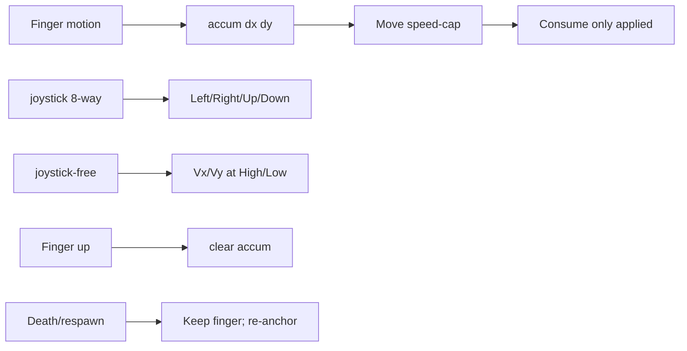

# THSSS 触控对标 th06

相对 [touch-th01-parity.plan.md](touch-th01-parity.plan.md) 已落地的 th01 路径，改为以 th06（`ports/th06/src/Touch.cpp` + `Player.cpp` 直触／摇杆）为行为基准。

## 现状 vs th06

| 点 | 先前 thsss（th01 向） | th06 |
| --- | --- | --- |
| 直触 | 相对像素队列 → `ApplyTouch`／`Move` | `g_AccumDx/Dy` → `Player` 欧式截断 + `ConsumePlayerDelta` |
| Focus 余量 | 本帧改用 LowSpeed 步长 | 截断前后按 focus 速度比缩放剩余队列 |
| 抬手 | primary up **立刻 clear** | finger up **clear** accum（按住时余量继续） |
| 8 向摇杆 | JS quantize → 像素 `ApplyTouch` | `Controller` 合成 `TH_BUTTON_*` 方向键 |
| 自由摇杆 | 连续轴 × 原速 → `ApplyTouch` | 轴 × orthogonal(Focus) max → `horizontalSpeed/verticalSpeed` |
| TOUCH-09 | `Time<=70` 等窗吞掉触控 | 触点保持；可移后同一指继续，相对当前位置 |
| TOUCH-10 | 未接落率 | `UsedCheatMovementThisRun` → 结算落率 **100%** |
| Replay | 触控局 `.trpy` | Extension 录 DirectTouch／Joystick；直触标非 vanilla |

已与 th06 同向、可少改：相对拖、限速／无限速整段、双指低速／四指暂停／射击 latch、灵敏度 100–300→1.0–3.0。决死窗口 +5 帧不在本轮。

## 拟改行为

1. **直触余量**：`Move` 只消费本帧实际走出分量；按住保留余量，抬手清。Focus 时按 High/Low 比缩放剩余队列（对齐 th06，不只换 LowSpeed）。
2. **`joystick`**：改回方向键合成（对齐 th06 `Controller`），不再走 `ApplyTouch` 像素。
3. **`joystick-free`**：连续轴 × High/Low 写入速度，与直触队列分路径。
4. **TOUCH-09**：禁移／死亡窗不释放 primary、不清队列；`TouchShift` 在不可移动时拒绝消费，可移后以当前位置继续累加。
5. **TOUCH-10**：无限速且实际非零位移打标；`SlowRate` 按 th06 口径记为 **100.0%**。
6. **Replay**：继续 **触控局 `.trpy`／键位局 `.rpy`**（无 th06 ReplayExtension）；`.trpy` 仍录 keys+dx+dy；纯 8 向键位局可落 `.rpy`。

主要改动面：`THSSS.Browser/wwwroot/host/input/touch-bridge.mjs`、`touch-movement.mjs`、`ApplyTouch`／`Move` patch、禁移连续性、落率标记；测试与 `refresh-patches`。

## Tradeoff

- **离开 th01 抬手叙事**：抬手仍停，验收口径改为 th06「按住保留余量」+ focus 重映射。
- **8 向回键位**：轨迹与自由摇杆／直触不一致；斜向走原作对角线速度表。
- **TOUCH-09**：死亡／决死／`Time<=70` 与触点生命周期耦合；通过拒绝 `TouchShift` 保留 JS 队列，而不是吞掉位移。
- **`.trpy` 非 th06 带格式**：桌面原版不认；文件名隔离，不是协议对齐。
- **TOUCH-10**：本作用 `SlowRate` 字符串承载 100% 落率；启动器 UI 展示可另开。
- **文档**：本文件为当前触控基准；[touch-th01-parity.plan.md](touch-th01-parity.plan.md) 保留为历史实现记录。
