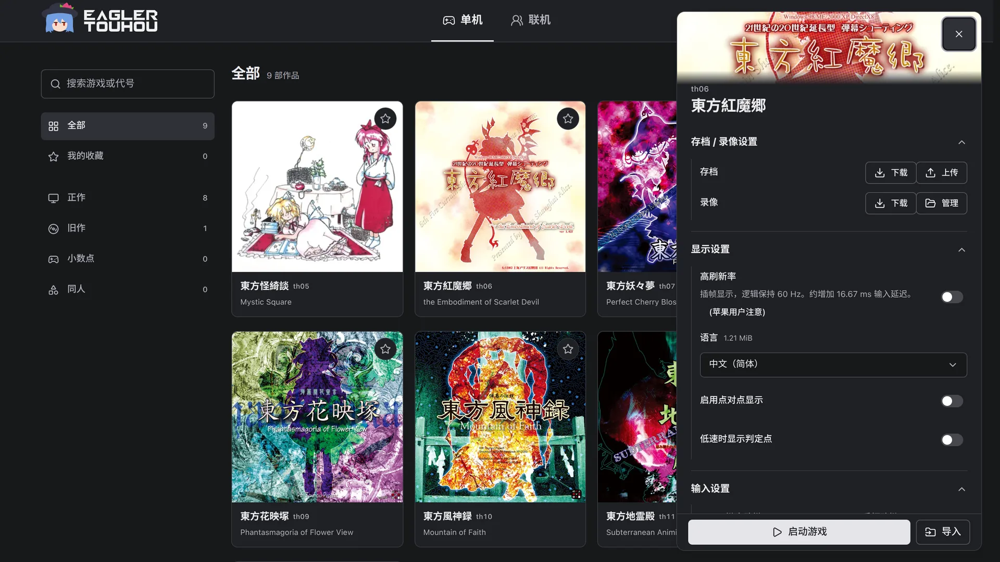
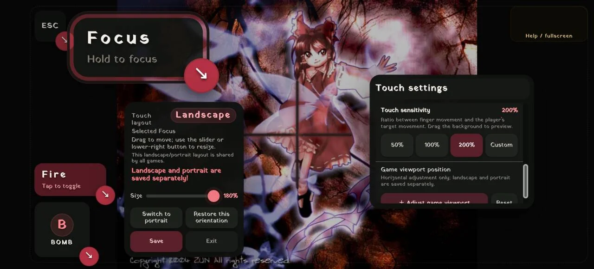
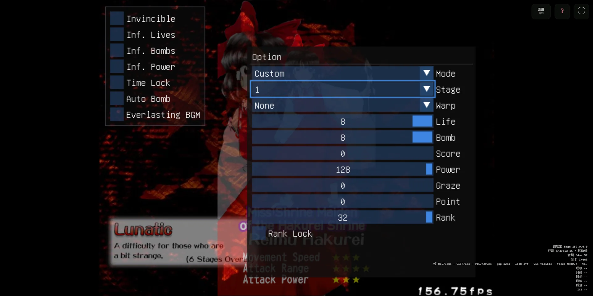
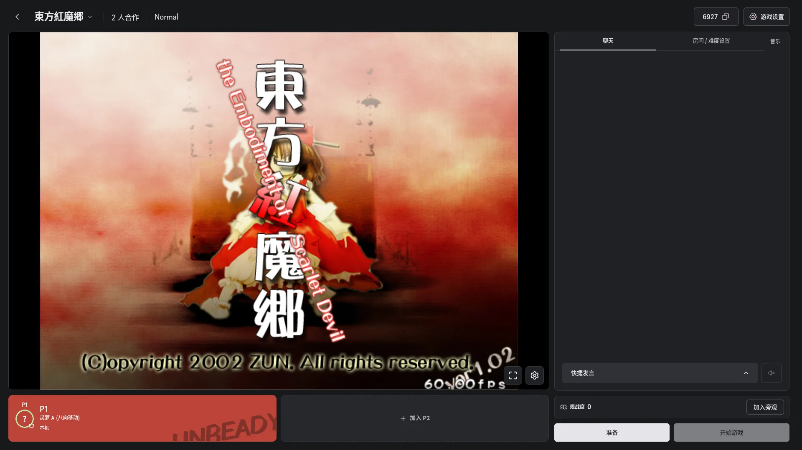

<h1 align="center">
  
</h1>

  
A <strong>Web adaptation project</strong> for official Touhou Project games, fangames, community tools, and multiplayer mods, aiming to <strong>greatly lower the barrier to entry</strong>.

  

    
    
    =108">
    
  

  
<a href="README.md">简体中文</a> | English

> [!TIP]
> For game support, see the [Game Restoration and Adaptation Progress](https://github.com/Ritosa2333/eagler-touhou/blob/main/docs/TOUHOU_PROGRESS.md). 
> If you have started working on a game, submit an Issue or PR to update the table. 
> If you are interested in reverse engineering the original games or adapting official games and Touhou fangames, join our [QQ group](https://qm.qq.com/q/eeUrxIltug?from=tim). We also have a developer group.

## Overview

The project's basic goal is to let users play **on any modern device without barriers**.

While preserving the original game experience, including some original bugs:

1. Provide high refresh rates, touch controls (direct movement and menu gestures), and popular STG community tools (thcrap and thprac).
2. Provide multiplayer built primarily around predictive rollback, with input delay as a supplement and strong tolerance for high latency.
3. Provide an updatable Web App that manages touch layouts, saves, and Replays and keeps working offline.
4. Provide a multiplayer lobby where players can join or spectate a game with just a few button presses.
5. Provide accounts, profiles, and cloud saves, so a run can continue on another device.
6. Maintain an active development team that updates quickly and welcomes feedback and criticism.

Nine titles are playable right now at [touhouonline.com](https://touhouonline.com/), each in single-player and online multiplayer.

## Available Titles

| Title | High refresh rate | thprac | Languages | Multiplayer |
| :--- | :---: | :---: | :---: | :---: |
| **th05** Mystic Square | - | ✅ | ✅ | Co-op, 2–3 players |
| **th06** Embodiment of Scarlet Devil | ✅ | ✅ | ✅ | Co-op, 2–3 players |
| **th07** Perfect Cherry Blossom | ✅ | ✅ | ✅ | Co-op, 2–3 players |
| **th08** Imperishable Night | ✅ | ✅ | ✅ | Co-op, 2–3 players |
| **th09** Phantasmagoria of Flower View | - | - | ✅ | Versus, 2 players |
| **th10** Mountain of Faith | ✅ | ✅ | ✅ | Co-op, 2–3 players |
| **th11** Subterranean Animism | ✅ | ✅ | ✅ | Co-op, 2–3 players |
| **th12** Undefined Fantastic Object | ✅ | ✅ | ✅ | Co-op, 2–3 players |
| **th15** Legacy of Lunatic Kingdom | ✅ | ✅ | ✅ | Co-op, 2–3 players |

All nine support keyboard, gamepad, and touch, come with save and Replay management, and can be spectated online.

More titles are being adapted; see the [game progress table](../docs/TOUHOU_PROGRESS.md) for restoration, porting, and adaptation status. Published early-access titles can be enabled under Developer options → Beta features in the top-right menu.

## Features

### The Complete Original Game Experience

- Run games in the browser with keyboard, gamepad, and touch controls. See the [game progress table](../docs/TOUHOU_PROGRESS.md) for support by title.
- Import and export original-format saves and Replays. Inputs supported by the original format remain interoperable; adaptation inputs that it cannot record use extension data.
- Aims for a polished experience. It fixes numerous issues inherited from the original portable branches, including jittery bullets, uneven bullet movement, flickering, music stutters when switching tracks in single-threaded mode, and poor performance on phones.
- Supports refresh rates above 60 Hz: frames are interpolated for display while game logic stays at the original 60 Hz. Available in th06, th07, th08, th10, th11, th12, and th15. \[Thanks to [reallyportable](https://github.com/some100/th07/tree/reallyportable)\]
- th06, th07, and th08 offer OGG or MIDI music, and MIDI can be sent to an external MIDI device.
- th05, a PC-98 title, runs the native C++ game logic of [uth05win](https://github.com/Goan114/uth05win-vibe) directly on WebAssembly and shares the same Launcher, input, Replay, and multiplayer features as the Windows titles.
- The library offers cover and list views with search, favorites, sorting, and categories. The Replay manager supports folders, renaming, and importing `.rpy`, `.rpyx`, and Replay ZIP files; pick a Replay to play it directly and choose the starting stage.
- The interface is available in Simplified Chinese, English, and Japanese, with dark and light themes.

### Input Settings

The default-expanded Input Settings group sits above Advanced Settings. The Keyboard tab provides Arrow keys and WASD presets plus named custom layouts. The Gamepad tab supports per-device button/axis learning, thresholds, and saved profiles. When enabled, Launcher gamepad mapping takes priority over in-game controller settings and requires updated Runtime packages.

The WASD layout retains original controls: arrows / WASD to move, Z / K to shoot, X / J for Bomb, Shift / L / Space to focus, and C / H for the title's existing C action. New aliases take priority when keys conflict and require updated game Runtime packages.

TH09 has a separate Local two-player editor with per-player keyboard/controller selection, saved layouts and conflict checks. Original left/right keyboard halves, WASD and arrow-key presets are available. Enabling it overrides local versus device settings without changing single-player or online mappings.

### Touch Controls

- Your touch path becomes the player's movement path. Available movement methods include Touch, Touch (cheat, unlimited speed), Joystick, and more. \[Thanks to [reallyportable](https://github.com/some100/th07/tree/reallyportable)\]
- Customizable touch layouts. Touch buttons can be freely moved and scaled from 60% to 300%.
- Landscape and portrait layouts can be saved separately.
- Rolling back to an older Launcher resets saved layouts that use scales above 180%.
- A Magnifier lets players zoom the game viewport at any time with a two-finger gesture. No more losing bullets because they are too small to see (x
- Touch Replays preserve the touch trajectory actually sent to the game.
- Menu gestures: swipe to move the selection cursor, tap to confirm, and tap with two fingers to go back. \[by [reallyportable](https://github.com/some100/th07/tree/reallyportable)\]
- Adjustable touch sensitivity.
- Adjustable default game viewport position.
- Multiple Focus methods, including hold, toggle, and two-finger controls.

### Popular STG Community Tools

#### thprac

- Provides [thprac](https://github.com/touhouworldcup/thprac) integration for th05, th06, th07, th08, th10, th11, th12, and th15.
- Touch devices can operate practice menus, with virtual buttons for opening the Tab Tracker and cheat menu.
- thprac practice Replays are saved together with their practice parameters and can be played back from the Launcher.

#### thcrap Languages

- Provides [thcrap](https://srv.thpatch.net/) language-pack support.
- Available languages depend on the game adaptation and the packs offered by the site.
- Servers can choose which language packs to offer for each game. You can throw in a whole pile of unusual language packs; players download only the one they select.

### Multiplayer Lobby

- All nine available titles have a multiplayer version: th05MP, th06MP, th07MP, th08MP, th10MP, th11MP, th12MP, and th15MP are 2–3 player co-op, and th09MP is 2-player versus.
- th06MP and th07MP are based on the [th07MP rules](https://github.com/sbrik1111/th07_multi_player). The full rules for each title are in the [multiplayer guide](content/MULTIPLAYER.md) (Chinese).
- Co-op is built around rescuing each other: transfer a life to revive a teammate who has become a ghost, and hand Power to teammates. The deathbomb window is twice the original, and damage dealt to bosses scales with the number of active players.
- Extra, Phantasm, every character, and every route are selectable online from the start.
- The host can turn on Challenge mode: Bombs are removed and the life bar counts deaths instead.
- Predictive rollback can be toggled in the room. With rollback off, Adonis measures the real input channel and negotiates the input delay, or the delay can be set manually.
- The lobby lists public rooms with their title, difficulty, and state, ready to join or spectate. Create a room by picking a title, then share the 4–8 digit room code or the invite link. Unlisted rooms stay out of the lobby and are joined by code.
- Players pick a seat, character, and difficulty—including Extra and Phantasm—and the game starts once everyone is ready.
- Rooms include chat and quick chat. Listen together searches NetEase Cloud Music and QQ Music for songs and public playlists and plays them in sync with everyone in the room.
- Players connect directly over WebRTC by default and switch adaptively to a TURN backup path within the same session while the game keeps running. Check network in the lobby tests connectivity before a room is opened, and the Service status page shows the site, download, multiplayer, and TURN services.
- Any player can pause; restart a run by pressing R while paused or by using the restart control.
- Multiplayer Replays can be saved, by spectators as well once the run ends.
- Spectators do not occupy player seats and can only watch rather than affect game state.
- Spectating is built on streaming Replays. In th06, th07, th08, th10, th11, and th15, spectators can join after the game has started, pause on the timeline, jump to stage and boss markers, and return to live with one click.
- Single-player and multiplayer saves and Replays are isolated. Settings may still be shared.

### Accounts and Profiles

- Playing and online multiplayer work without signing in. An account adds a profile, friends, and cloud saves.
- Profiles have overview, career, play history, content, and friends tabs, show the Touhou clear chart, favorite games, and recently launched titles, and let players follow each other.
- The Touhou clear chart exports to PNG and can be exported and imported as JSON.
- Cloud saves sync the saves of supported titles across devices. When local and cloud progress differ, the player chooses which version to keep.
- Profile visibility is configured under Privacy & display.

### Game Packages and Offline Play

- Install game packages from the site or import a ZIP containing a legally owned copy of the game.
- Installed packages remain in the browser. Game data, OGG music, fonts, and language packs can be managed independently, while Runtime components are provided by the site.
- Browsers that support installation can add the Launcher as an app. In secure contexts such as HTTPS or a trusted loopback address, installed games and the Launcher can run offline.
- Original game data imported by the player is never uploaded to the server; it remains in the browser.

Operators can choose among three modes based on their resources and bandwidth:

- **Hosted**: the site serves the Launcher, Runtime components, and all game resources. Players can install games directly, while the site carries all resource traffic;
- **External**: the user-facing site serves the Launcher and Runtime components, while a separate complete resource site or CDN serves large game files. Players can still install games directly without sending large-file traffic through the frontend server;
- **Import**: the site serves only the Launcher and Runtime components and does not publish original game data. Players import a ZIP made from their legally owned game copy. This suits operators without a CDN traffic budget or who do not want to host original resources.

All three modes share the same frontend, browser-local game packages, and offline-play support. Self-hosted sites run in guest mode by default with anonymous multiplayer available on its own; connecting a compatible account service enables sign-in, profiles, and cloud saves. See the [self-hosting guide](docs/SELF_HOSTING.md) for complete deployment instructions.

## Contributing

This repository maintains the Launcher, the games, the shared runtime library, and standalone services together:

| Directory | Contents |
| :--- | :--- |
| [`launcher/`](README.en.md) | Launcher frontend: library, file management, multiplayer lobby, accounts and profiles |
| [`ports/`](../ports/README.md) | Runtime source and Web adaptation for each title, with its multiplayer version |
| [`common/`](../common/README.md) | Shared runtime library, browser modules, and contracts, including the Product Catalog |
| `services/` | Relay, TURN, resource router, and telemetry services |
| [`docs/`](../docs/README.md) | Adaptation workflow, netplay and rollback architecture, and the game progress table |

Start with [CONTRIBUTING.md](../CONTRIBUTING.md), then pick a component in [WORKSPACE.md](../WORKSPACE.md). Every document is listed in the [documentation index](../docs/INDEX.md). (Developer documentation is in Chinese.)

## Frequently Asked Questions

See the [FAQ](docs/FAQ.md). The website page is generated from this Markdown source. (Only Chinese is currently available.)

## License

Licensed under the [GNU General Public License v3.0 or later](LICENSE).

Complete third-party source, asset attribution, and licensing information is available in [THIRD_PARTY.md](THIRD_PARTY.md) and [ASSETS.md](ASSETS.md).

## Star History

